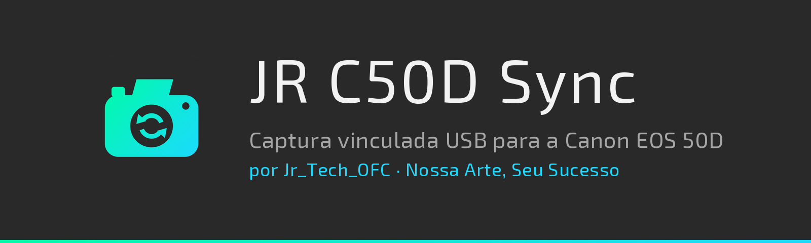
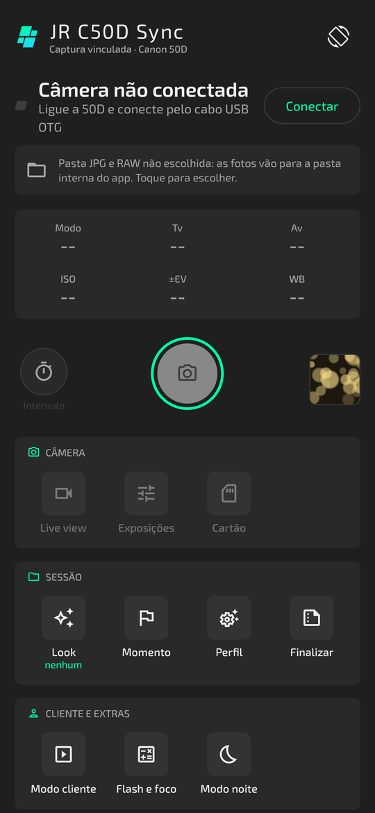
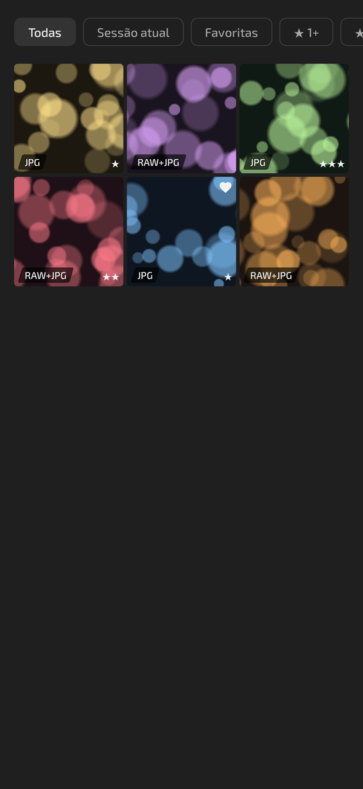
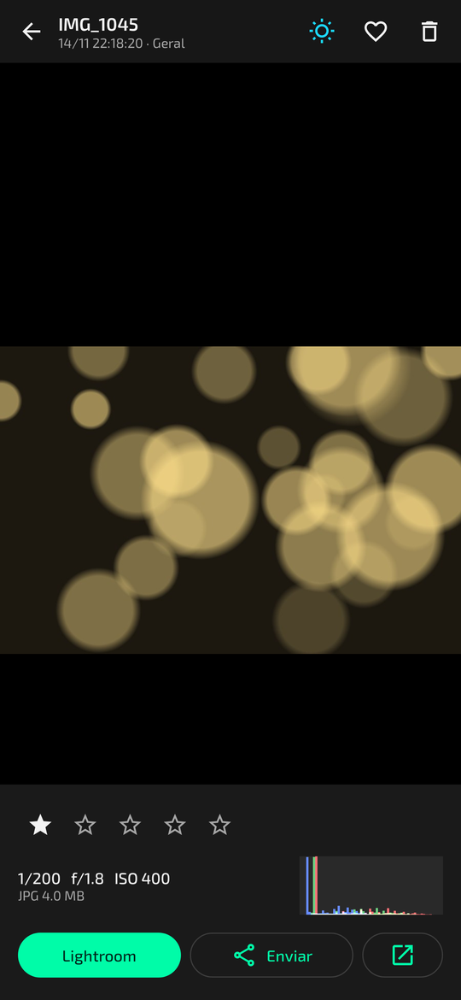
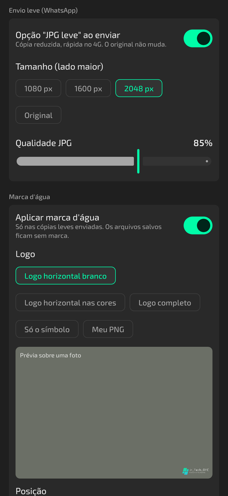
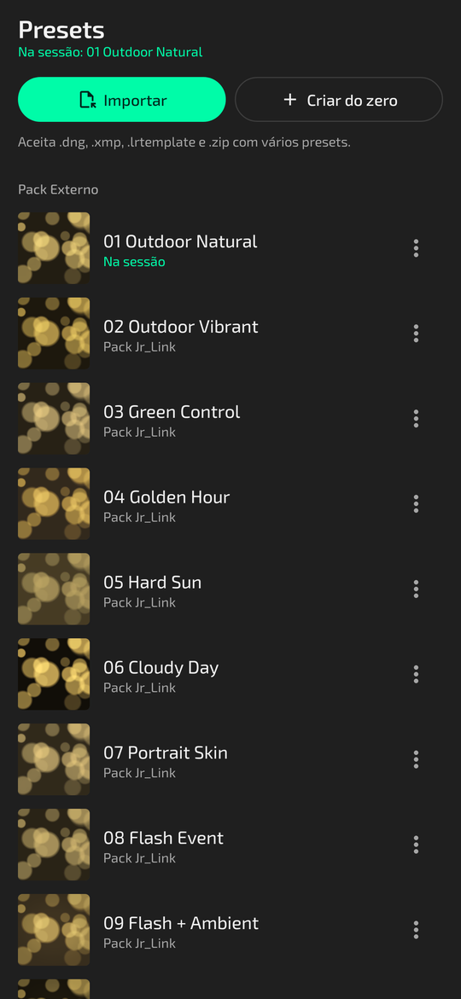
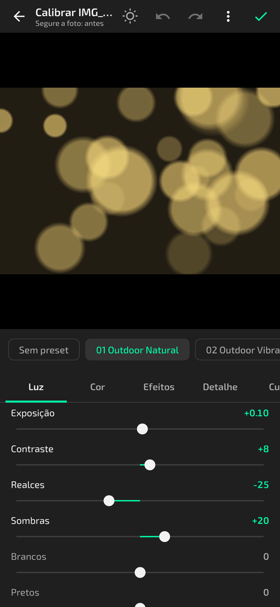
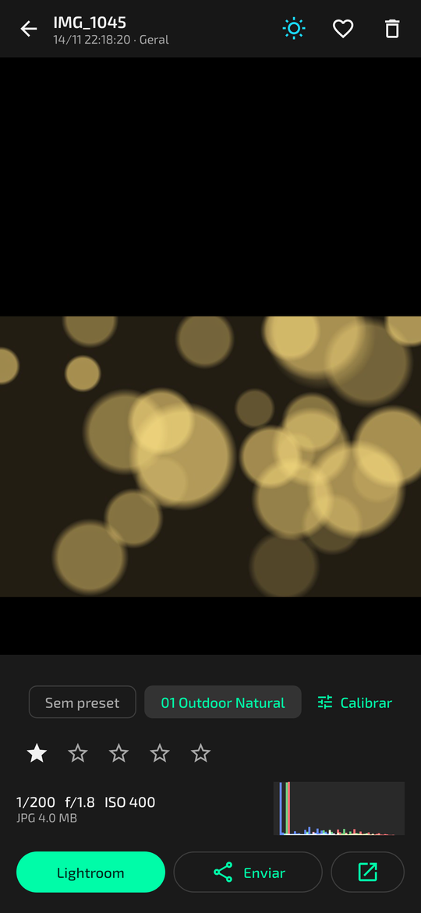
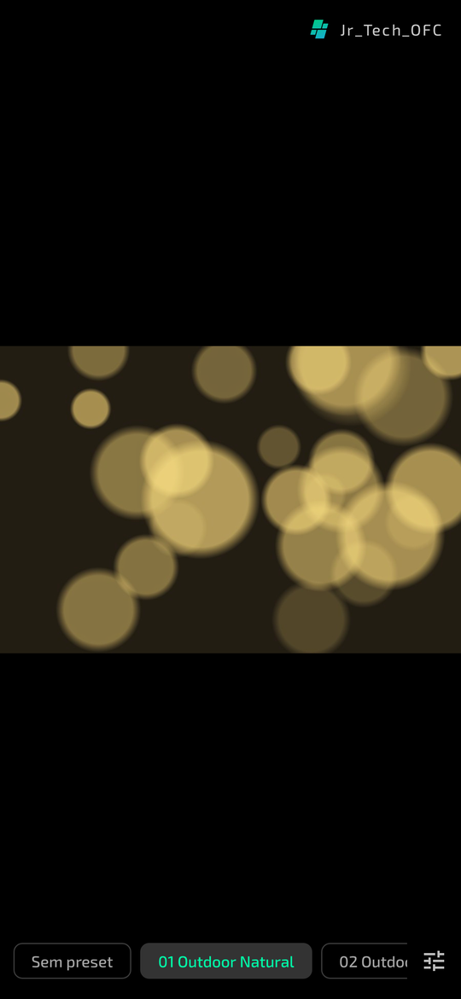
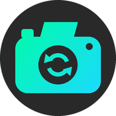

<p align="center">
  
</p>

<p align="center">
  <a href="https://github.com/jrtechofcdev/Canon-50D-Remote/releases/latest"></a>
  
  
  
  <a href="https://github.com/jrtechofcdev/Canon-50D-Remote/actions/workflows/build.yml"></a>
</p>

<p align="center">
  <a href="https://github.com/jrtechofcdev/Canon-50D-Remote/releases/latest"><b>Baixar o APK (última versão)</b></a>
  &nbsp;·&nbsp;
  <a href="release/">APK direto no repositório</a>
  &nbsp;·&nbsp;
  <a href="CHANGELOG.md">Novidades</a>
</p>

---

Você fotografa pela **Canon EOS 50D** como sempre, com botão, dials e menus funcionando. Cada foto vai para o cartão CF e **uma cópia chega sozinha no celular** pelo cabo USB OTG, salva em RAW, JPG ou nos dois, cada formato na pasta que você escolher.

Sem Wi-Fi, sem FTP, sem Live View. Só a USB, só a 50D.

<table>
  <tr>
    <td align="center"><br><sub><b>Sessão</b><br>última foto, exposição, disparador</sub></td>
    <td align="center"><br><sub><b>Fotos</b><br>RAW/JPG, favoritas, estrelas</sub></td>
    <td align="center"><br><sub><b>Visualizador</b><br>zoom, histograma, Lightroom</sub></td>
    <td align="center"><br><sub><b>Envio</b><br>JPG leve e marca d'água</sub></td>
  </tr>
  <tr>
    <td align="center"><br><sub><b>Presets</b><br>importar DNG, XMP, LRTemplate</sub></td>
    <td align="center"><br><sub><b>Editor</b><br>painéis do Lightroom</sub></td>
    <td align="center"><br><sub><b>Look</b><br>preset na foto e Calibrar</sub></td>
    <td align="center"><br><sub><b>Modo cliente</b><br>o cliente escolhe o preset</sub></td>
  </tr>
</table>

<sub>Telas renderizadas a partir do código, com fotos de exemplo.</sub>

## O que ele faz

| | |
|---|---|
| **Captura vinculada** | Fotos feitas pelo botão da câmera ou pelo disparador do app chegam sozinhas no celular. A câmera nunca fica travada. |
| **Auto-save** | Só JPG, só RAW ou RAW + JPG. Pasta própria para cada formato (inclusive cartão SD), subpasta por sessão, renomeação com o nome do cliente. |
| **Revisão** | Slide automático para a foto nova, zoom para conferir foco, histograma RGB, alerta de estouro piscando, estrelas de 1 a 5 e favoritas. |
| **Controle da câmera** | ISO, abertura, velocidade, ±EV e balanço de branco lidos da própria 50D. Exposições salvas, bracketing (AEB) e intervalômetro. |
| **Presets** | Importa presets do Lightroom em DNG, XMP, LRTemplate ou ZIP. Edita e cria do zero num editor com os painéis do Lightroom. A foto aparece já com o preset, como um perfil de cor, e uma cópia JPG editada fica salva ao lado do original. |
| **Cartão** | Navegar pelas fotos que já estão no CF e baixar só as escolhidas. Reenvio automático do que foi feito com o cabo solto. |
| **Envio** | Lightroom com um toque, "JPG leve" para WhatsApp e marca d'água Jr_Tech_OFC aplicada só na cópia enviada. |
| **Cliente** | Modo cliente em tela cheia, com PIN para sair e resumo ao fim da sessão. O cliente escolhe o preset da foto; o botão Calibrar (com PIN) abre os ajustes daquela foto. |
| **Campo** | Vibração a cada foto, alerta se o cabo soltar, aviso de cartão e memória cheios, modo escuro total para igreja e evento noturno. |

Cada função tem um liga/desliga em **Ajustes**.

## Instalar

1. Baixe o APK na [página de versões](https://github.com/jrtechofcdev/Canon-50D-Remote/releases/latest) ou na pasta [`release/`](release/).
2. Abra o arquivo no celular e permita **instalar apps desconhecidos** quando o Android pedir.
3. Atualizações instalam por cima e mantêm suas fotos e ajustes.

## Usar com a 50D

1. Na câmera, deixe **Desligamento automático** em **Desativado** (menu de configuração, ícone amarelo).
2. Ligue a 50D e conecte o cabo **USB OTG** no celular.
3. O Android pergunta se deve abrir o **Jr_Link**. Marque **Usar por padrão** para ele abrir e liberar a USB sozinho das próximas vezes.
4. Na primeira vez, vá em **Ajustes → Salvamento** e escolha as pastas dos JPG e dos RAW.
5. Fotografe.

O disparador do app funciona como apertar o botão até o fim: com AF ligado, a câmera foca antes e, sem foco, não dispara. Em MF ou com AF-ON o disparo é imediato.

### Presets

1. Na aba **Presets**, toque em **Importar** e escolha o arquivo baixado (`.dng`, `.xmp`, `.lrtemplate` ou um `.zip` com vários). O app lê os ajustes e guarda o preset no grupo **Importados**.
2. Toque no preset para editar: **Luz, Cor (com mistura de cores e P&B), Efeitos, Detalhe, Curva, Color grading e Calibração**. Segure a foto para ver o antes. Duplo toque no nome do ajuste volta ao zero.
3. No menu **⋮** do preset, **Usar na sessão**. Cada foto nova já chega com ele. Na Sessão, o chip **Look** troca o preset rápido.
4. No visualizador, a faixa embaixo da foto troca o preset e **Calibrar** ajusta só aquela foto. No menu do editor ficam **Aplicar às próximas fotos** e **Salvar como preset**.
5. Em **Ajustes → Presets**, escolha a **pasta de presets** (cada um é salvo lá em `.xmp`, pronto para o Lightroom) e a **pasta das editadas**.

**Limites:** o processamento da Adobe é fechado, então a prévia do Jr_Link é uma aproximação. O `.xmp` exportado dá o resultado exato no Lightroom. Máscaras, remoção de manchas, correção de lente e perfis de câmera da Adobe não são aplicados; o corte também não, porque não faz parte de um preset.

<details>
<summary><b>Se algo der errado</b></summary>

| Sintoma | O que fazer |
|---|---|
| "Câmera não conectada" | Confira se a 50D está ligada e se o cabo é OTG. Toque em **Conectar**. |
| "Permissão USB negada" | Toque em **Conectar** e depois em **Permitir**. |
| "Outro app está usando a câmera" | Feche outros apps de câmera ou USB e tente de novo. |
| Foto não chega | Confira se o formato em Ajustes inclui o que a câmera grava (câmera em RAW e app em "Só JPG" não baixa nada). |
| Não dispara pelo app | AF sem foco. Use MF ou AF-ON. |
| Preset não importa | O arquivo precisa ter ajustes do Lightroom dentro. DNG de preset sim; DNG de foto comum sem ajustes, não. |
| Qualquer outro erro | **Ajustes → Diagnóstico → Copiar log** e abra um [relato de problema](https://github.com/jrtechofcdev/Canon-50D-Remote/issues/new/choose) com o log. |

Ao tocar em **Encerrar conexão**, a câmera sai do modo PC e volta ao normal.
</details>

## Gerar o APK

Precisa de **JDK 17** e do **Android SDK** (ou do Android Studio recente, que já traz os dois).

```bash
./gradlew :app:assembleDebug          # Windows: gradlew.bat :app:assembleDebug
```

O APK sai em `app/build/outputs/apk/debug/app-debug.apk`.

```bash
./gradlew :app:testDebugUnitTest      # testes do protocolo PTP, presets, processamento, marca d'água, migração do banco
```

Para publicar uma versão nova: suba o `versionName` em `app/build.gradle.kts` e anote as mudanças no `CHANGELOG.md`. Quando isso chega na `main`, o GitHub Actions compila, testa, cria a tag `vX.Y` e publica o APK na página de versões.

<details>
<summary><b>Estrutura do código</b></summary>

```
app/src/main/java/com/example/
├── TetherApp.kt                   cria as peças do app (câmera, banco, configurações)
├── MainActivity.kt                navegação: Sessão, Fotos, Presets, Ajustes
├── core/
│   ├── ptp/                       protocolo PTP da Canon: pacotes, sessão USB, eventos, valores
│   ├── camera/CameraManager.kt    conexão com a 50D, eventos, disparo, ISO/Av/Tv, AEB, cartão
│   ├── tether/TetherController.kt auto-save: baixa cada foto nova e grava na pasta certa
│   ├── storage/                   pastas escolhidas + preview extraído do CR2
│   ├── data/                      banco de fotos (Room), configurações e presets (DataStore)
│   ├── preset/                    presets: leitura de DNG/XMP/LRTemplate, XMP para exportar, pack inicial
│   ├── render/                    processamento dos presets (OpenGL na GPU, com versão na CPU de reserva)
│   ├── analysis/                  histograma e máscara de estouro
│   ├── export/                    JPG leve e marca d'água
│   ├── alerts/                    vibração e notificações de alerta
│   └── service/                   mantém a conexão com a tela apagada
└── ui/                            telas em Jetpack Compose
```
</details>

<details>
<summary><b>Onde personalizar</b></summary>

| Quero mudar… | Onde |
|---|---|
| Cores da marca e do tema | `ui/theme/Theme.kt` → `Brand`, `DayPalette`, `NightPalette` |
| Nome do app | `app/src/main/res/values/strings.xml` |
| Padrões das opções | `core/data/AppSettings.kt` → `Settings` |
| Logos da marca d'água | `app/src/main/assets/watermarks/` (gerados por `branding/render.py`) |
| Ícone do app | `branding/symbol.py` |
| Banner deste README | `branding/banner.py` |
| Presets que vêm com o app | `core/preset/StarterPresets.kt` |
| Sliders e faixas do editor | `ui/preset/EditorControls.kt` |
| Textos das telas | `ui/session`, `ui/photos`, `ui/preset`, `ui/settings` |
</details>

## Documentação

- [`CHANGELOG.md`](CHANGELOG.md): o que mudou em cada versão.
- [`docs/AUDITORIA.md`](docs/AUDITORIA.md): por que a versão 1.0 travava a câmera e como a 2.0 resolveu.
- [`DESIGN.md`](DESIGN.md) e [`branding/`](branding/): identidade visual, cores, fonte e símbolo.

## Créditos

**Jr_Link** é um app da **Jr_Tech_OFC** ([@jose_renato_a](https://instagram.com/jose_renato_a)).
Uso exclusivo. Marca, logo e nome Jr_Tech_OFC: todos os direitos reservados.

Fonte [Exo 2](https://github.com/googlefonts/Exo-2.0) (SIL Open Font License). Protocolo PTP da Canon com base na documentação do [libgphoto2](https://github.com/gphoto/libgphoto2).

<p align="center"><br><sub>Nossa Arte, Seu Sucesso</sub></p>
