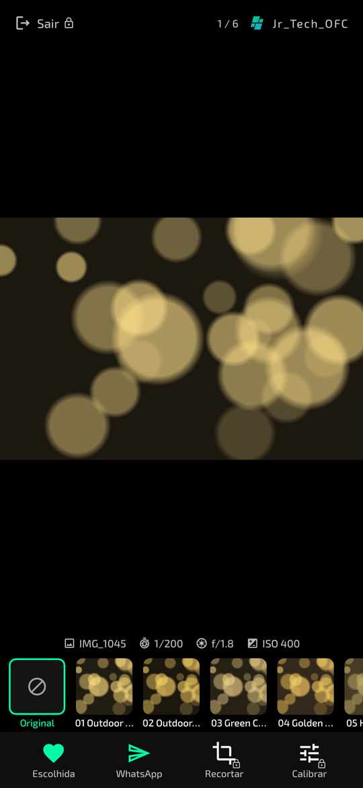
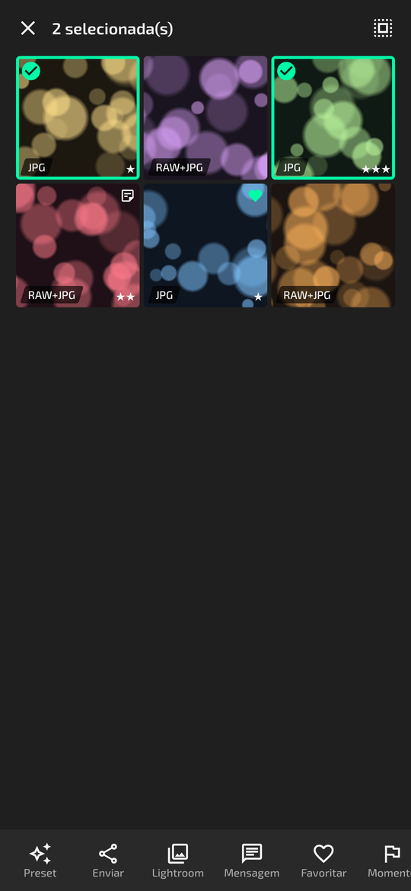
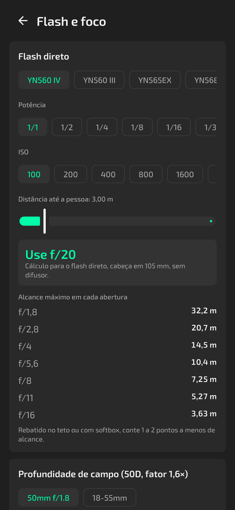
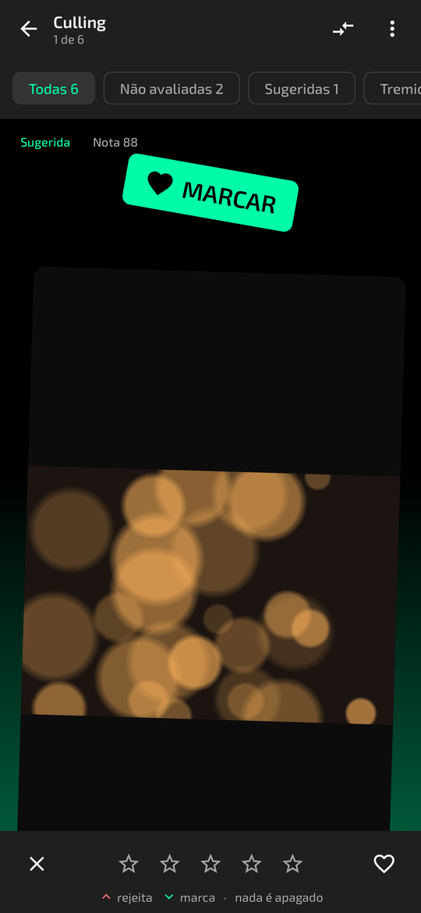
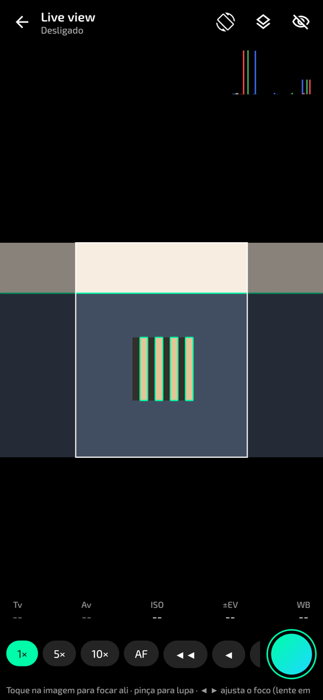
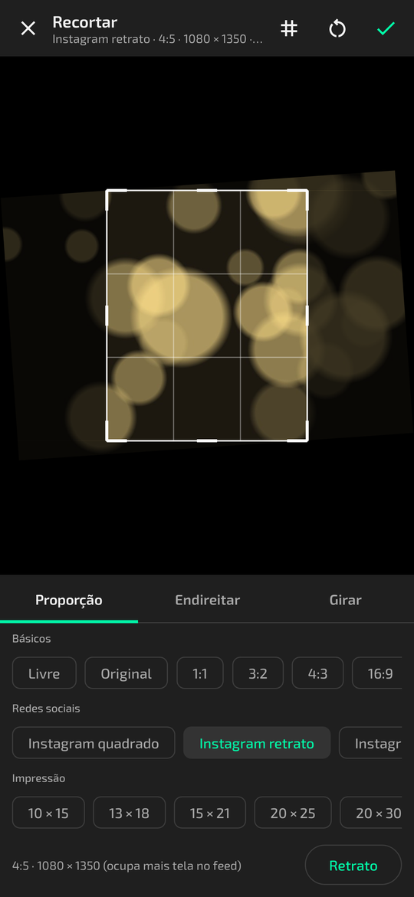
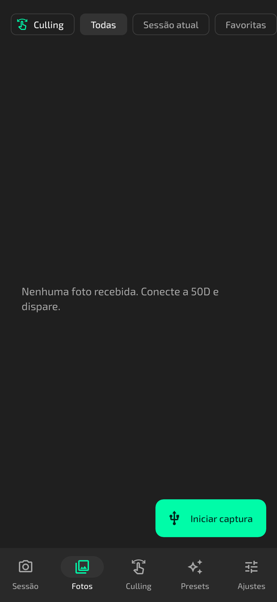
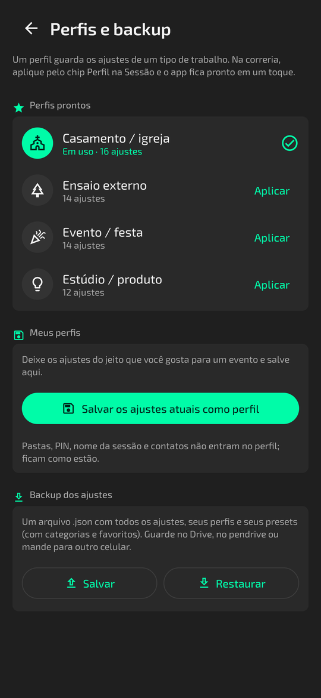

<p align="center">
  
</p>

<p align="center">
  <a href="https://github.com/jrtechofcdev/Canon-50D-Remote/releases/latest"></a>
  
  
  
  <a href="https://github.com/jrtechofcdev/Canon-50D-Remote/actions/workflows/build.yml"></a>
</p>

<p align="center">
  <a href="https://github.com/jrtechofcdev/Canon-50D-Remote/releases/latest"><b>Baixar o APK (última versão)</b></a>
  &nbsp;·&nbsp;
  <a href="release/">APK direto no repositório</a>
  &nbsp;·&nbsp;
  <a href="CHANGELOG.md">Novidades</a>
</p>

---

Você fotografa pela **Canon EOS 50D** como sempre, com botão, dials e menus funcionando. Cada foto vai para o cartão CF e **uma cópia chega sozinha no celular** pelo cabo USB OTG, salva em RAW, JPG ou nos dois, cada formato na pasta que você escolher.

Sem Wi-Fi, sem FTP, sem internet. Só a USB, só a 50D. (A única parte que usa internet é a Loja de presets, e só para pegar presets novos.)

<table>
  <tr>
    <td align="center"><br><sub><b>Sessão</b><br>última foto, exposição, disparador</sub></td>
    <td align="center"><br><sub><b>Fotos</b><br>RAW/JPG, favoritas, estrelas</sub></td>
    <td align="center"><br><sub><b>Visualizador</b><br>zoom, histograma, Lightroom</sub></td>
    <td align="center"><br><sub><b>Envio</b><br>JPG leve e marca d'água</sub></td>
  </tr>
  <tr>
    <td align="center"><br><sub><b>Presets</b><br>importar DNG, XMP, LRTemplate</sub></td>
    <td align="center"><br><sub><b>Editor</b><br>painéis do Lightroom</sub></td>
    <td align="center"><br><sub><b>Look</b><br>preset na foto e Calibrar</sub></td>
    <td align="center"><br><sub><b>Modo cliente</b><br>o cliente escolhe o preset</sub></td>
  </tr>
  <tr>
    <td align="center"><br><sub><b>Seleção</b><br>o cliente marca as fotos</sub></td>
    <td align="center"><br><sub><b>Lote</b><br>preset, envio e mensagem de uma vez</sub></td>
    <td align="center"><br><sub><b>Flash e foco</b><br>Yongnuo e profundidade de campo</sub></td>
    <td align="center"><br><sub><b>Culling</b><br>arraste para marcar ou rejeitar</sub></td>
  </tr>
  <tr>
    <td align="center"><br><sub><b>Live view</b><br>monitor com preset ao vivo</sub></td>
    <td align="center"><br><sub><b>Recorte</b><br>Instagram, Stories, impressão</sub></td>
    <td align="center"><br><sub><b>Iniciar captura</b><br>em qualquer aba</sub></td>
    <td align="center"><br><sub><b>Perfis</b><br>ajustes prontos por evento</sub></td>
  </tr>
</table>

<sub>Telas renderizadas a partir do código, com fotos de exemplo.</sub>

## O que ele faz

| | |
|---|---|
| **Captura vinculada** | Fotos feitas pelo botão da câmera ou pelo disparador do app chegam sozinhas no celular. A câmera nunca fica travada. Botão **Iniciar captura** em todas as abas. |
| **Live view** | A imagem da 50D no celular como monitor externo: preset em tempo real (igual perfil de cor), guias de enquadramento (terços, 4:5, 9:16), zebra, focus peaking, histograma, toque para focar, zoom 5×/10×, foco fino, prévia de profundidade, exposição e disparo. |
| **Recorte** | Recorte no estilo Lightroom: proporções prontas para Instagram, Stories/Reels/Status, Facebook, YouTube e impressão (10×15 a A4), livre, endireitar (manual, Auto e traçando o horizonte), girar e espelhar. Recorte rápido em lote. |
| **Auto-save** | Só JPG, só RAW ou RAW + JPG. Pasta própria para cada formato (inclusive cartão SD), subpasta por sessão, renomeação com o nome do cliente. |
| **Revisão** | Slide automático para a foto nova, zoom para conferir foco, histograma RGB, alerta de estouro piscando, estrelas de 1 a 5 e favoritas. |
| **Controle da câmera** | ISO, abertura, velocidade, ±EV e balanço de branco lidos da própria 50D. Exposições salvas, bracketing (AEB) e intervalômetro. |
| **Presets** | Importa presets do Lightroom em DNG, XMP, LRTemplate ou ZIP. Edita e cria do zero num editor com os painéis do Lightroom. A foto aparece já com o preset, como um perfil de cor, e uma cópia JPG editada fica salva ao lado do original. |
| **Loja de presets** | Aba com os presets grátis da sua API: prévia de cada DNG, antes e depois segurando o dedo, seleção de vários, abrir no Lightroom, prévia na sua foto, **Usar** numa foto da galeria ou no editor, **Salvar** em Meus presets (funciona offline em todo o app) e **Baixar** o DNG e o XMP para a pasta `JR_LR_Presets`. |
| **Cartão** | Navegar pelas fotos que já estão no CF e baixar só as escolhidas. Reenvio automático do que foi feito com o cabo solto. |
| **Envio** | Lightroom com um toque, "JPG leve" com marca d'água Jr_Tech_OFC e **WhatsApp direto para o número do cliente**: digita o número e a conversa abre com a foto pronta (preset, recorte e marca d'água) já anexada. |
| **Cliente** | Modo cliente em tela cheia com zoom (pinça e duplo toque), PIN para sair e resumo ao fim da sessão. O cliente pode receber a foto no WhatsApp dele. O cliente escolhe o preset da foto; o botão Calibrar (com PIN) abre os ajustes daquela foto. |
| **Entrega** | O cliente marca as fotos no modo cliente; a lista vai para o filtro do Lightroom ou para a pasta Escolhidas. Galeria em lote e mensagens prontas no WhatsApp. |
| **Evento** | Momentos (Cerimônia, Festa…) com subpasta, notas de texto e voz por foto, backup da sessão para cartão SD ou pendrive. |
| **Seleção com análise local** | Avisa na hora se a foto saiu tremida ou se alguém piscou, agrupa fotos parecidas e sugere a melhor. Aba **Culling** com gestos. Roda no celular, sem internet (Google ML Kit embutido). |
| **Ferramentas** | Calculadora de flash Yongnuo e de profundidade de campo, GPS nas cópias e acerto do relógio da câmera. Tudo offline. |
| **Campo** | Vibração a cada foto, alerta se o cabo soltar, aviso de cartão e memória cheios, modo escuro total para igreja e evento noturno. |

Cada função tem um liga/desliga em **Ajustes**.

## Instalar

1. Baixe o APK na [página de versões](https://github.com/jrtechofcdev/Canon-50D-Remote/releases/latest) ou na pasta [`release/`](release/).
2. Abra o arquivo no celular e permita **instalar apps desconhecidos** quando o Android pedir.
3. Atualizações instalam por cima e mantêm suas fotos e ajustes.

## Usar com a 50D

1. Na câmera, deixe **Desligamento automático** em **Desativado** (menu de configuração, ícone amarelo).
2. Ligue a 50D e conecte o cabo **USB OTG** no celular.
3. O Android pergunta se deve abrir o **JR C50D Sync**. Se o app já estiver aberto, toque em **Iniciar captura** (botão verde no canto). Marque **Usar por padrão** para ele abrir e liberar a USB sozinho das próximas vezes.
4. Na primeira vez, vá em **Ajustes → Salvamento** e escolha as pastas dos JPG e dos RAW.
5. Fotografe.

O disparador do app funciona como apertar o botão até o fim: com AF ligado, a câmera foca antes e, sem foco, não dispara. Em MF ou com AF-ON o disparo é imediato.

### Presets

1. Na aba **Presets**, toque em **Importar** e escolha o arquivo baixado (`.dng`, `.xmp`, `.lrtemplate` ou um `.zip` com vários). O app lê os ajustes e guarda o preset no grupo **Importados**.
2. Toque no preset para editar: **Luz, Cor (com mistura de cores e P&B), Efeitos, Detalhe, Curva, Color grading e Calibração**. Segure a foto para ver o antes. Duplo toque no nome do ajuste volta ao zero.
3. No menu **⋮** do preset, **Usar na sessão**. Cada foto nova já chega com ele. Na Sessão, o chip **Look** troca o preset rápido.
4. No visualizador, a faixa embaixo da foto troca o preset e **Calibrar** ajusta só aquela foto. No menu do editor ficam **Aplicar às próximas fotos** e **Salvar como preset**.
5. Em **Ajustes → Presets**, escolha a **pasta de presets** (cada um é salvo lá em `.xmp`, pronto para o Lightroom) e a **pasta das editadas**.

**Análise local:** os limites de "tremida" vêm de testes com imagens de exemplo. Se o alerta avisar demais ou de menos nas suas fotos, ajuste a sensibilidade em **Ajustes → Revisão**.

**Limites:** o processamento da Adobe é fechado, então a prévia do app é uma aproximação. O `.xmp` exportado dá o resultado exato no Lightroom. Máscaras, remoção de manchas, correção de lente e perfis de câmera da Adobe não são aplicados; o corte também não, porque não faz parte de um preset.

### Loja de presets

1. Abra a aba **Loja**. A lista vem da sua API (endereço em **Ajustes → Presets → Loja de presets**).
2. Filtre por categoria ou busque pelo nome. Toque num preset para ver a prévia grande. **Segure o dedo na foto para ver sem o preset** (a foto original que vem dentro do DNG), como no Lightroom; um toque deixa em tela cheia. **Na minha foto** mostra o preset aplicado numa foto sua.
   Para vários de uma vez: na grade, **segure um preset**, marque os outros e toque em **Salvar** ou **Baixar**.
3. **Usar numa foto:** escolha a foto e toque em **Aplicar e ver** ou **No editor**.
4. **Salvar:** o preset vai para **Meus presets** e funciona sem internet no live view, no modo cliente, no visualizador e nas fotos novas. **Fotos novas** salva e já aplica nas próximas fotos.
5. **Abrir no Lightroom:** o DNG abre no Lightroom do celular. Lá, toque em ⋮ → **Criar predefinição** para guardar o preset no Lightroom.
6. **Baixar DNG e XMP:** grava na pasta de presets, dentro de `JR_LR_Presets/JR_LR_Presets_DNG` e `JR_LR_Presets/JR_LR_Presets_XMP`. Se a pasta ainda não foi escolhida, o app pede na hora.

A Loja precisa de internet só para ver e pegar presets novos. Sem sinal, ela mostra a lista salva da última vez.

### Live view

1. Na 50D, ative uma vez: **Menu → Configurações de Live View → Disparo com Live View: Ativar**. Deixe o dial em P, Tv, Av ou M.
2. Com a câmera conectada, toque em **Live view** na Sessão.
3. No botão de camadas escolha o **preset em tempo real** (nenhum, o look da sessão ou qualquer preset), a guia (terços, Instagram 4:5, Stories 9:16…), zebra, peaking e histograma.
4. Toque na imagem para escolher o ponto de foco e use o botão **AF** para focar. **5×/10×** amplia pela câmera e a pinça é uma lupa no celular. Os ícones de montanha (longe) e flor (perto) e as setas mexem o foco com a lente na chave AF. Segure o botão de profundidade para ver a profundidade de campo.
5. O ícone de girar abre o menu das posições (em pé, deitado para cada lado, de cabeça para baixo ou automático) e vale para o app todo. O ícone de tela cheia deixa só a imagem, com o disparador.

**Menos barulho:** o app pede o AF **Modo Live**, que foca pelo sensor sem descer o espelho. Se a 50D não aceitar pelo cabo, escolha na câmera: Menu → Live View → **Modo AF: Modo Live** e **Disparo silencioso: Modo 1**.

**Disparo:** se a câmera ainda está focando, o app insiste até disparar (até 5 s, ajustável nas opções do monitor). O botão mostra *Focando…*, *Disparou* ou *Não disparou* com o motivo.

Live view gasta mais bateria da câmera. Com a imagem só no celular, a tela da 50D fica apagada; dá para manter nas duas em "Mostrar também na tela da câmera".

### Recorte e WhatsApp

- **Recortar:** no visualizador, toque no ícone de recorte. Escolha a proporção (Instagram 4:5, Stories 9:16, 10×15…), arraste a moldura para enquadrar e use **Endireitar** (régua, **Auto** ou **Traçar horizonte**). O recorte vale para a tela, a cópia editada e o envio. O arquivo original não muda.
- **Recorte rápido:** na galeria, segure para selecionar várias fotos → **Recorte** → formato. Cada foto recebe o maior recorte centralizado.
- **WhatsApp direto:** no visualizador, na galeria em lote ou no modo cliente, toque em **WhatsApp**, coloque o nome e o número com DDD e siga os dois botões:
  1. **Abrir conversa:** abre o chat daquele número já com a mensagem automática (Ajustes → Mensagens → Envio das fotos). Envie a mensagem.
  2. **Enviar fotos:** volte ao app e toque em 2. As fotos vão para a mesma conversa.

  O WhatsApp só pula a tela "Enviar para" quando a conversa já existe; por isso a mensagem vai antes. Os números usados ficam em Recentes (no modo cliente eles não aparecem).

### Posição da tela

- O botão de girar (Sessão, visualizador, modo cliente e live view) abre um menu com as posições: em pé, deitado para cada lado, de cabeça para baixo e Automático. Nas posições fixas a tela não gira sozinha.
- **Girar com a foto** (Ajustes → Tela): no visualizador e no modo cliente, foto em pé deixa a tela em pé e foto deitada deixa a tela deitada, sempre em tela cheia.
- Se a 50D salvar fotos verticais deitadas, ligue na câmera **Menu → Girar automático: Ligado**, ou use **Girar** no visualizador.

### Log do app

O app escreve um diário em arquivo no celular (um por dia, os últimos 10 dias): conexão, downloads, memória, telas, avisos e erros. Se ele fechar sozinho, o erro fica gravado, e na próxima abertura **Ajustes → Diagnóstico** mostra como ele fechou.

- **Salvar log completo:** desligado, só erros e fechamentos são gravados, para o máximo de desempenho.
- **Pasta dos logs:** escolha uma pasta (Downloads, cartão SD) e o arquivo é copiado para lá a cada 15 s.
- **Compartilhar:** junta os últimos dias em um arquivo para mandar pelo WhatsApp, Drive ou e-mail.

### Perfis e backup

- **Ajustes → Perfis e backup** tem sets prontos (Casamento / igreja, Ensaio externo, Evento / festa, Estúdio / produto). Deixe o app do seu jeito e salve como perfil. Na Sessão, o chip **Perfil** troca tudo em um toque.
- Pastas, PIN, nome da sessão e contatos não mudam com o perfil.
- **Backup dos ajustes:** salva um .json com ajustes, perfis e presets. Em **Restaurar**, os ajustes do arquivo substituem os atuais, e perfis e presets são somados aos que você já tem.

<details>
<summary><b>Se algo der errado</b></summary>

| Sintoma | O que fazer |
|---|---|
| "Câmera não conectada" | Confira se a 50D está ligada e se o cabo é OTG. Toque em **Conectar**. |
| "Permissão USB negada" | Toque em **Conectar** e depois em **Permitir**. |
| "Outro app está usando a câmera" | Feche outros apps de câmera ou USB e tente de novo. |
| Foto não chega | Confira se o formato em Ajustes inclui o que a câmera grava (câmera em RAW e app em "Só JPG" não baixa nada). |
| Não dispara pelo app | AF sem foco. Use MF ou AF-ON. |
| Live view não aparece | Ative o Disparo com Live View no menu da 50D (Configurações de Live View) e use P, Tv, Av ou M. |
| WhatsApp abre "Enviar para" | Use o botão **1 · Abrir conversa** primeiro e mande a mensagem; depois o **2 · Enviar fotos** vai direto para o cliente. |
| WhatsApp abre sem a foto | Atualize o WhatsApp. Sem ele instalado, o app abre o link wa.me do número só com o texto. |
| Preset não importa | O arquivo precisa ter ajustes do Lightroom dentro. DNG de preset sim; DNG de foto comum sem ajustes, não. |
| App fechou sozinho | Abra de novo e vá em **Ajustes → Diagnóstico**: o aviso no topo diz como ele fechou. Toque em **Compartilhar** e mande o arquivo de log. |
| Qualquer outro erro | **Ajustes → Diagnóstico → Compartilhar** e abra um [relato de problema](https://github.com/jrtechofcdev/Canon-50D-Remote/issues/new/choose) com o arquivo de log. |

Ao tocar em **Encerrar conexão**, a câmera sai do modo PC e volta ao normal.
</details>

## Gerar o APK

Precisa de **JDK 17** e do **Android SDK** (ou do Android Studio recente, que já traz os dois).

```bash
./gradlew :app:assembleDebug          # Windows: gradlew.bat :app:assembleDebug
```

O APK sai em `app/build/outputs/apk/debug/app-debug.apk`.

```bash
./gradlew :app:testDebugUnitTest      # testes do protocolo PTP, presets, processamento, marca d'água, migração do banco
```

Para publicar uma versão nova: suba o `versionName` em `app/build.gradle.kts` e anote as mudanças no `CHANGELOG.md`. Quando isso chega na `main`, o GitHub Actions compila, testa, cria a tag `vX.Y` e publica o APK na página de versões.

<details>
<summary><b>Estrutura do código</b></summary>

```
app/src/main/java/com/example/
├── TetherApp.kt                   cria as peças do app (câmera, banco, configurações)
├── MainActivity.kt                navegação: Sessão, Fotos, Culling, Presets, Ajustes + botão Iniciar captura
├── core/
│   ├── ptp/                       protocolo PTP da Canon: pacotes, sessão USB, eventos, valores
│   ├── camera/CameraManager.kt    conexão com a 50D, eventos, disparo, ISO/Av/Tv, AEB, cartão
│   ├── tether/TetherController.kt auto-save: baixa cada foto nova e grava na pasta certa
│   ├── storage/                   pastas escolhidas + preview extraído do CR2
│   ├── data/                      banco de fotos (Room), configurações e presets (DataStore)
│   ├── preset/                    presets: leitura de DNG/XMP/LRTemplate, XMP para exportar, pack inicial
│   ├── render/                    processamento dos presets (OpenGL na GPU, com versão na CPU de reserva)
│   ├── analysis/                  histograma, estouro, peaking e a seleção local (nitidez, rostos, nota)
│   ├── live/                      live view: leitura dos quadros e processamento (preset, zebra, peaking)
│   ├── messages/                  modelos de mensagem do WhatsApp
│   ├── tools/                     contas de flash e profundidade de campo
│   ├── backup/  location/  notes/ backup da sessão, GPS e notas de voz
│   ├── export/                    JPG leve e marca d'água
│   ├── alerts/                    vibração e notificações de alerta
│   └── service/                   mantém a conexão com a tela apagada
└── ui/                            telas em Jetpack Compose
```
</details>

<details>
<summary><b>Onde personalizar</b></summary>

| Quero mudar… | Onde |
|---|---|
| Cores da marca e do tema | `ui/theme/Theme.kt` → `Brand`, `DayPalette`, `NightPalette` |
| Nome do app | `app/src/main/res/values/strings.xml` |
| Padrões das opções | `core/data/AppSettings.kt` → `Settings` |
| Logos da marca d'água | `app/src/main/assets/watermarks/` (gerados por `branding/render.py`) |
| Ícone do app | `branding/icon.py` (gera o vetor, os WebP e a prévia `branding/icone_jr_c50d_sync.png`) |
| Banner deste README | `branding/banner.py` |
| Presets que vêm com o app | `core/preset/StarterPresets.kt` |
| Sliders e faixas do editor | `ui/preset/EditorControls.kt` |
| Mensagens padrão do WhatsApp | `core/messages/MessageTemplates.kt` (ou em Ajustes → Mensagens) |
| Flashes da calculadora | `core/tools/FieldMath.kt` → `Flash` |
| Proporções do recorte | `core/render/Crop.kt` → `CropRatio` |
| Textos das telas | `ui/session`, `ui/photos`, `ui/preset`, `ui/settings` |
</details>

## Documentação

- [`CHANGELOG.md`](CHANGELOG.md): o que mudou em cada versão.
- [`docs/AUDITORIA.md`](docs/AUDITORIA.md): por que a versão 1.0 travava a câmera e como a 2.0 resolveu.
- [`DESIGN.md`](DESIGN.md) e [`branding/`](branding/): identidade visual, cores, fonte e símbolo.

## Créditos

**JR C50D Sync** é um app da **Jr_Tech_OFC** ([@jose_renato_a](https://instagram.com/jose_renato_a)).
Uso exclusivo. Marca, logo e nome Jr_Tech_OFC: todos os direitos reservados.

Fonte [Exo 2](https://github.com/googlefonts/Exo-2.0) (SIL Open Font License). Protocolo PTP da Canon com base na documentação do [libgphoto2](https://github.com/gphoto/libgphoto2).

<p align="center"><br><sub>Nossa Arte, Seu Sucesso</sub></p>
