<p align="center">
  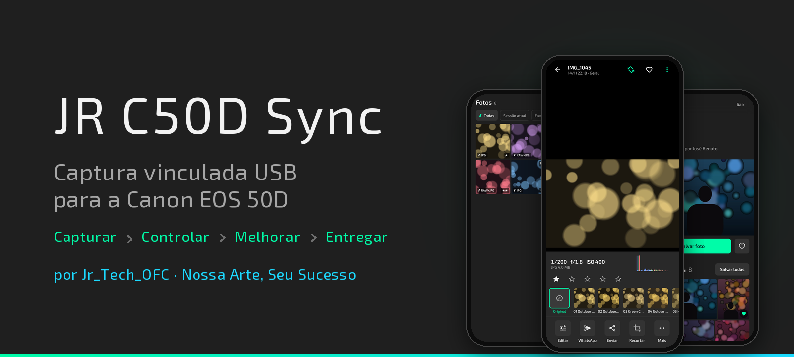
</p>

<p align="center">
  
  
  
  
  
</p>

<p align="center">
  <a href="release/JR_C50D_Sync-v5.1.apk"><b>⬇ Baixar o APK 5.1</b></a>
  &nbsp;·&nbsp;
  <a href="#instalar">Instalar</a>
  &nbsp;·&nbsp;
  <a href="#guias">Guias</a>
  &nbsp;·&nbsp;
  <a href="CHANGELOG.md">Novidades</a>
</p>

---

Você fotografa pela **Canon EOS 50D** como sempre, com botão, dials e menus funcionando. Cada foto vai para o cartão CF e **uma cópia chega sozinha no celular** pelo cabo USB OTG, em RAW, JPG ou nos dois, cada formato na pasta que você escolher.

Na hora de entregar, o celular cria o próprio Wi-Fi e o cliente baixa as fotos pelo QR. **Nada disso usa internet.** A única parte online é a Loja de presets, e só para pegar presets novos.

<table>
  <tr>
    <td align="center" width="25%">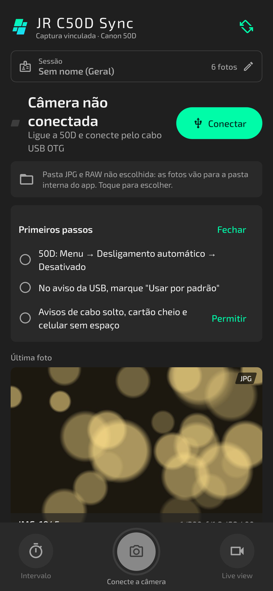<br><sub><b>Sessão</b><br>câmera, última foto e disparador</sub></td>
    <td align="center" width="25%">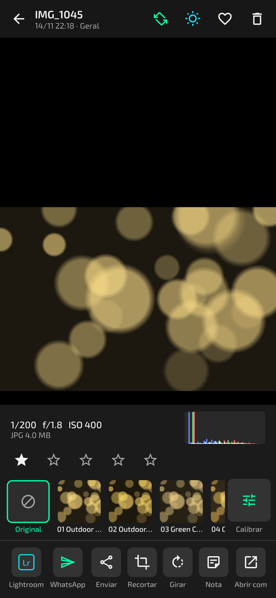<br><sub><b>Visualizador</b><br>EXIF, histograma, presets</sub></td>
    <td align="center" width="25%">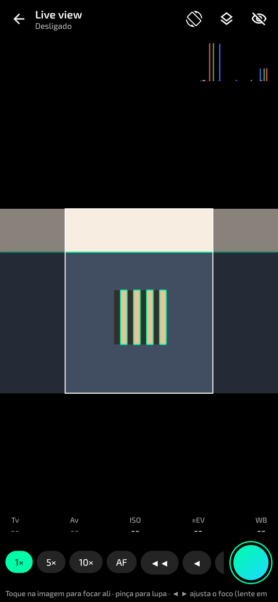<br><sub><b>Live view</b><br>monitor com preset ao vivo</sub></td>
    <td align="center" width="25%">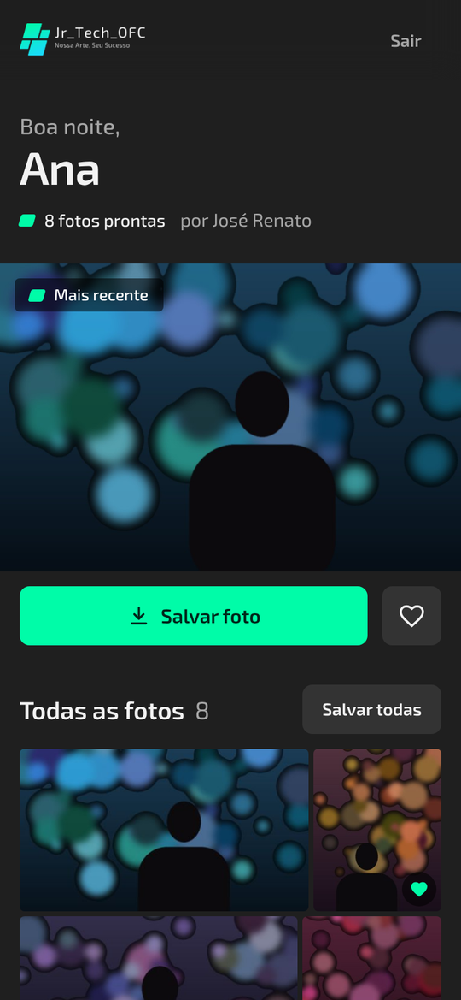<br><sub><b>Entrega</b><br>o cliente salva no celular dele</sub></td>
  </tr>
</table>

## Capturar → Controlar → Melhorar → Entregar

Cada função do app responde a uma etapa do trabalho no evento.

<table>
  <tr>
    <td width="50%" valign="top">

### 📸 Capturar
- **Captura vinculada:** fotos feitas pelo botão da câmera ou pelo disparador do app chegam sozinhas, e a câmera nunca trava.
- **Auto-save:** só JPG, só RAW ou os dois, com pasta para cada formato, subpasta por sessão e nome do cliente no arquivo.
- **Cartão:** navegue pelo CF, baixe só as escolhidas e recupere o que foi feito com o cabo solto.
- **Reconexão automática:** se o cabo falhar, o app tenta de novo e baixa o que faltou, sem repetir.

</td>
    <td width="50%" valign="top">

### 🎛 Controlar
- **Exposição:** ISO, abertura, velocidade, ±EV e balanço de branco lidos da 50D e alterados pelo celular.
- **Live view:**
  - toque para focar e foco fino;
  - zoom de 5× e 10×;
  - zebra, peaking, histograma e guias (terços, 4:5, 9:16).
- **Disparo inteligente:** espera o foco e diz por que não disparou. Também tem intervalômetro e bracketing (AEB).
- **Campo:** vibra a cada foto, avisa cabo solto, cartão e celular cheios, e tem modo escuro total para igreja.

</td>
  </tr>
  <tr>
    <td width="50%" valign="top">

### ✨ Melhorar
- **Presets do Lightroom:**
  - importa DNG, XMP, LRTemplate e ZIP;
  - editor com os painéis do Lightroom;
  - a foto já chega com o look.
- **Loja de presets:** prévias, antes e depois, "na minha foto" e download para o Lightroom.
- **Recorte:** Instagram, Stories, impressão, endireitar automático e recorte em lote.
- **Seleção local:** avisa foto tremida e olho fechado, agrupa as parecidas e o culling é por gestos. Roda sem internet.

</td>
    <td width="50%" valign="top">

### 📤 Entregar
- **Entrega local:**
  - o celular vira Wi-Fi;
  - cada cliente tem um código e um QR;
  - o cliente salva as fotos na hora.
- **Fotografia Express:**
  - prévia com marca d'água;
  - o cliente marca as favoritas;
  - Pix com o valor exato;
  - liberação sem marca depois do pagamento.
- **WhatsApp direto:** a conversa do cliente abre com a foto pronta (preset, recorte e marca d'água).
- **Modo cliente:** tela cheia com PIN, o cliente escolhe as fotos e o preset.

</td>
  </tr>
</table>

<p align="center">
  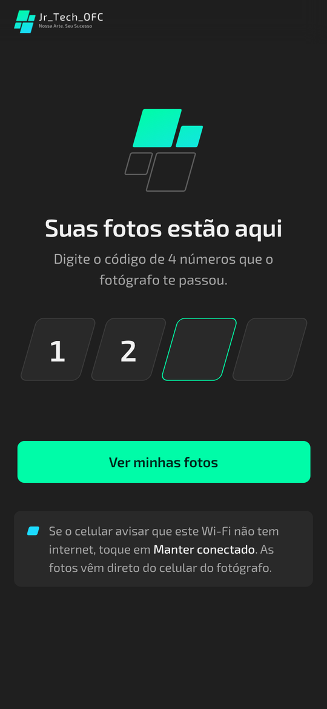
  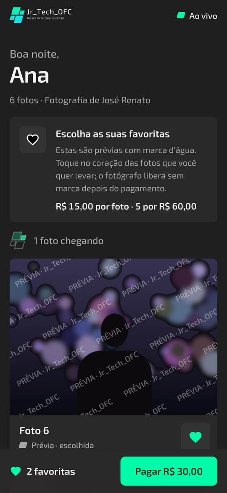
  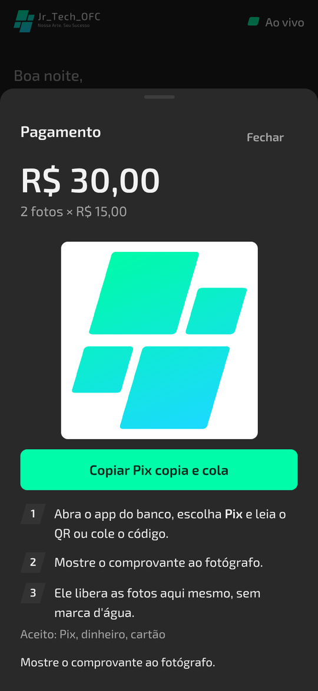
  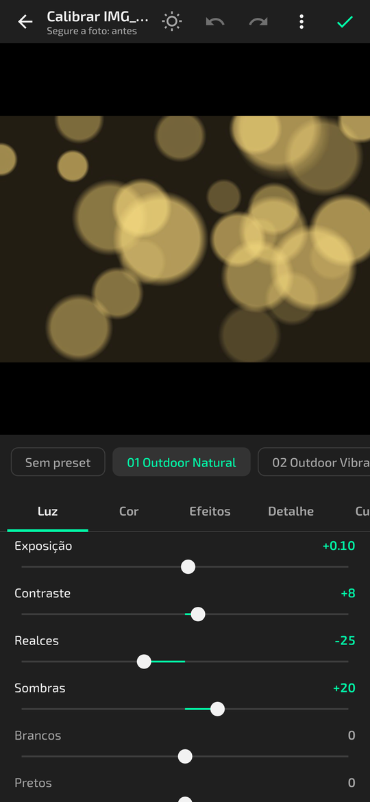
  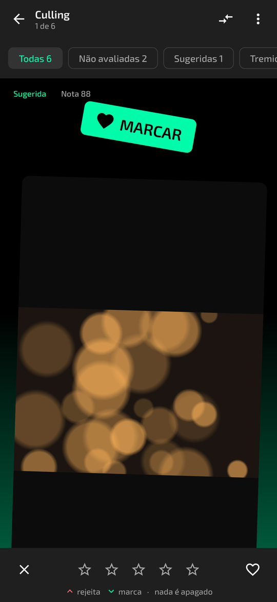
</p>

<details>
<summary><b>🖼 Ver todas as telas</b></summary>
<br>
<table>
  <tr>
    <td align="center" width="25%">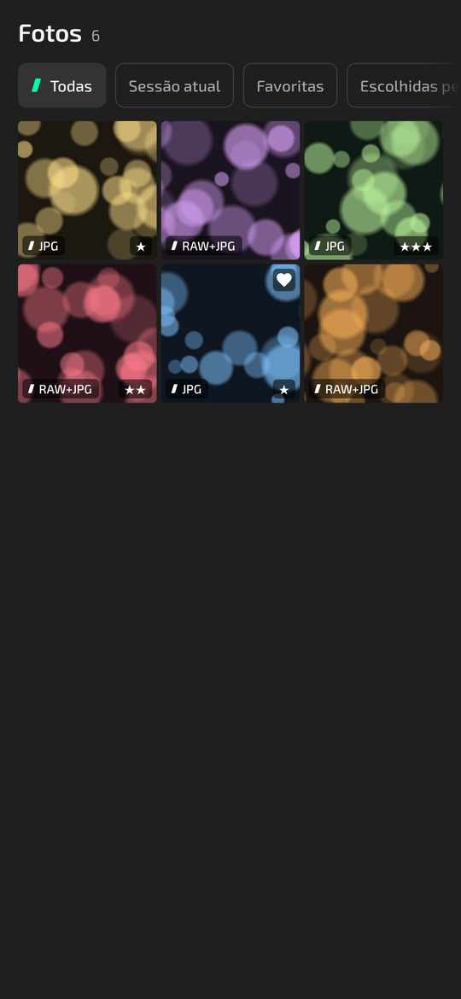<br><sub><b>Galeria</b><br>RAW/JPG, favoritas, estrelas</sub></td>
    <td align="center" width="25%">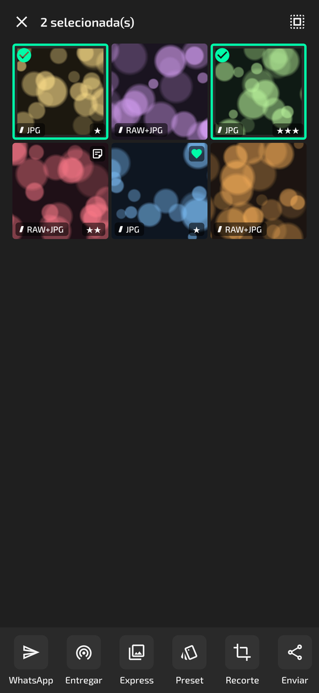<br><sub><b>Lote</b><br>preset, envio e mensagem de uma vez</sub></td>
    <td align="center" width="25%">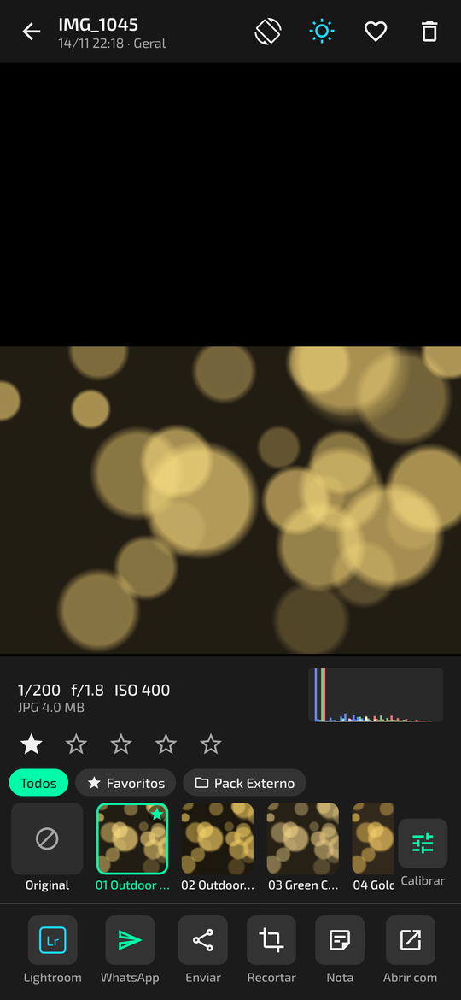<br><sub><b>Look</b><br>preset na foto e Calibrar</sub></td>
    <td align="center" width="25%">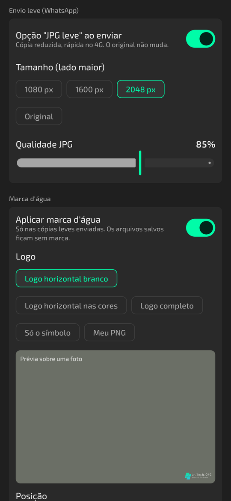<br><sub><b>Envio</b><br>JPG leve e marca d'água</sub></td>
  </tr>
  <tr>
    <td align="center">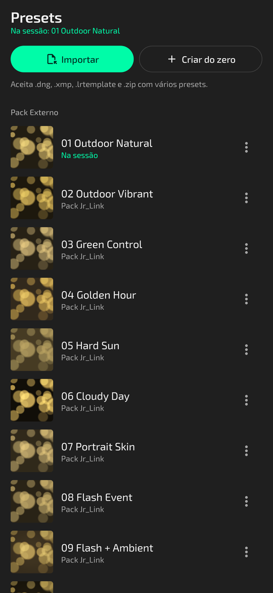<br><sub><b>Presets</b><br>DNG, XMP, LRTemplate</sub></td>
    <td align="center"><br><sub><b>Editor</b><br>painéis do Lightroom</sub></td>
    <td align="center">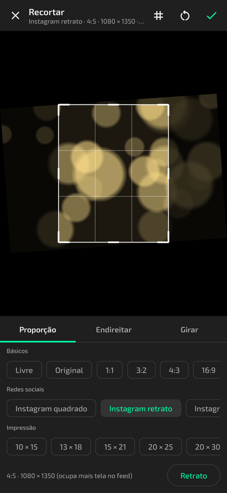<br><sub><b>Recorte</b><br>Instagram, Stories, impressão</sub></td>
    <td align="center"><br><sub><b>Culling</b><br>arraste para marcar ou rejeitar</sub></td>
  </tr>
  <tr>
    <td align="center">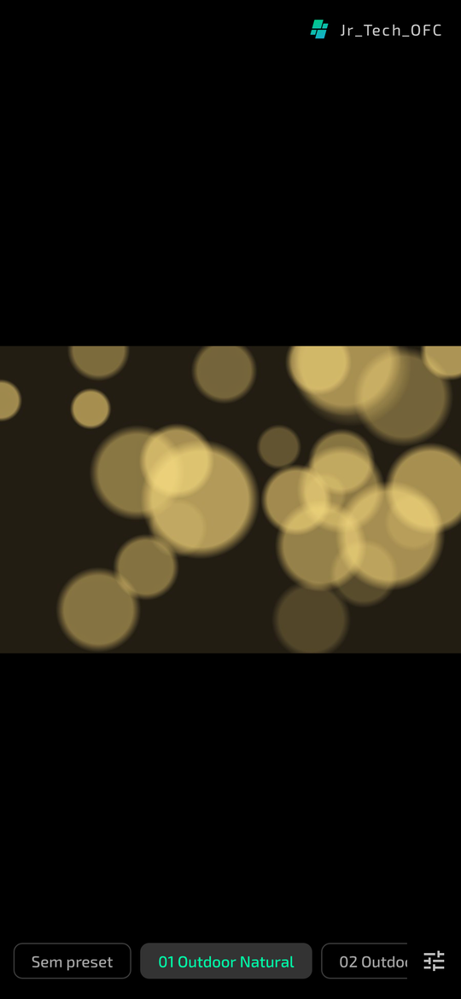<br><sub><b>Modo cliente</b><br>o cliente escolhe o preset</sub></td>
    <td align="center">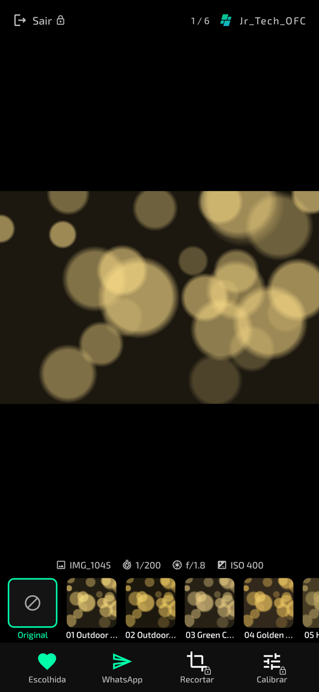<br><sub><b>Seleção</b><br>o cliente marca as fotos</sub></td>
    <td align="center">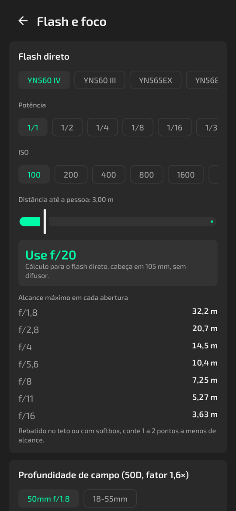<br><sub><b>Ferramentas</b><br>flash Yongnuo e profundidade</sub></td>
    <td align="center">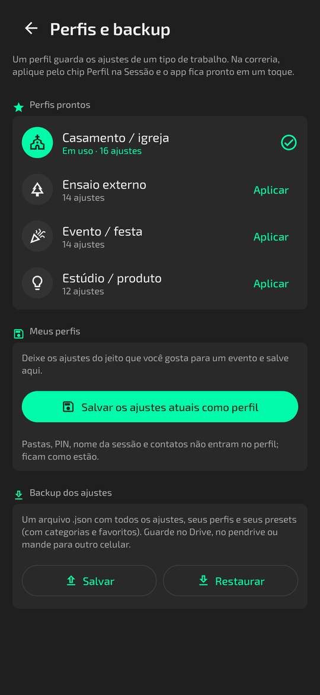<br><sub><b>Perfis</b><br>ajustes prontos por evento</sub></td>
  </tr>
  <tr>
    <td align="center">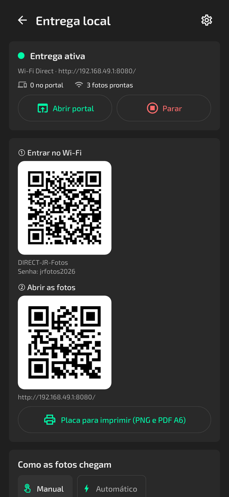<br><sub><b>Entrega local</b><br>Wi-Fi e QR do cliente</sub></td>
    <td align="center">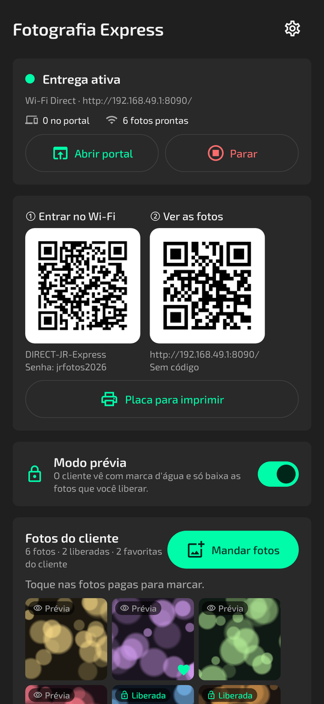<br><sub><b>Express</b><br>um cliente por vez</sub></td>
    <td align="center">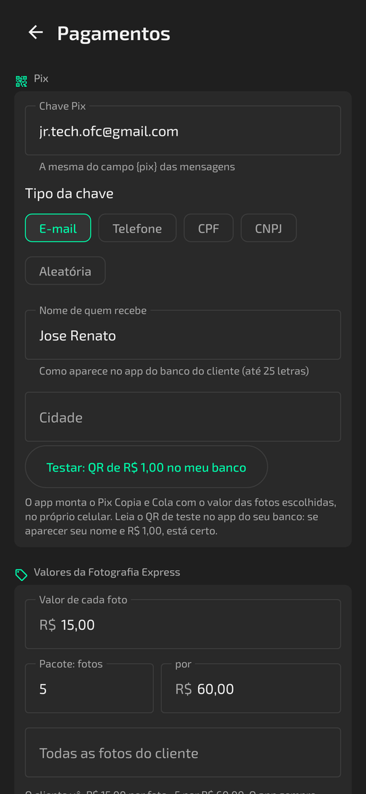<br><sub><b>Pagamentos</b><br>Pix com valor exato</sub></td>
    <td align="center">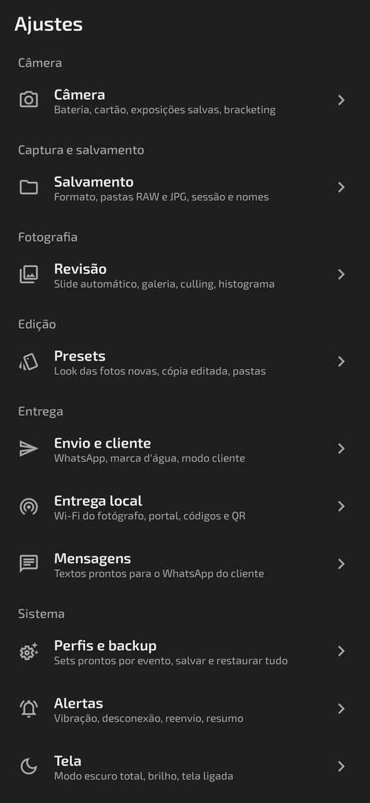<br><sub><b>Ajustes</b><br>agrupados por etapa, com busca</sub></td>
  </tr>
</table>
<p align="center">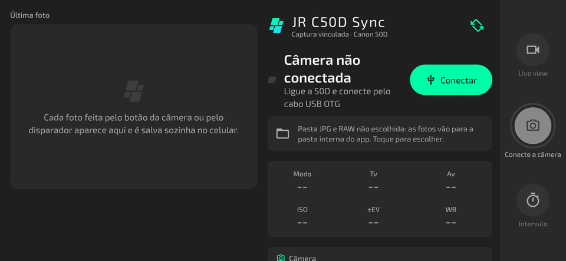<br><sub><b>Deitado:</b> foto, controles e disparador lado a lado</sub></p>
<p align="center"><sub>Telas renderizadas a partir do código, com fotos de exemplo.</sub></p>
</details>

## Instalar

1. Baixe o **[APK 5.1](release/JR_C50D_Sync-v5.1.apk)** (ou pela aba *Releases*, ao lado).
2. Abra o arquivo no celular e permita **instalar apps desconhecidos** quando o Android pedir.
3. As atualizações instalam por cima e mantêm suas fotos e ajustes.

**Com a 50D:**
1. Na câmera, deixe **Desligamento automático** em **Desativado** (menu de configuração, ícone amarelo).
2. Ligue a 50D e conecte o cabo **USB OTG** no celular.
3. No aviso do Android, escolha **JR C50D Sync** e marque **Usar por padrão**.
4. Na primeira vez, vá em **Ajustes → Salvamento** e escolha as pastas dos JPG e dos RAW (ou **Criar e ligar todas as pastas**).
5. Fotografe.

> O disparador do app funciona como apertar o botão até o fim: com AF ligado, a câmera foca antes e, sem foco, não dispara. Em MF ou com AF-ON, o disparo é imediato.

## Guias

<details>
<summary><b>🔌 Conexão e reconexão</b></summary>

- Se a conexão cair com o cabo ligado, o app tenta de novo sozinho por alguns minutos e a Sessão mostra **Reconectando…**.
- Ao voltar, as fotos feitas nesse intervalo são baixadas, sem repetir as que já chegaram.
- O ponto no ícone da aba Sessão mostra o estado em qualquer tela: menta conectada, ciano reconectando, vermelho falhou.
- Se a pasta escolhida parar de responder (cartão removido, pasta apagada), as fotos vão para a pasta interna do app e a Sessão pede para escolher a pasta de novo.
- Bateria fraca e cartão quase cheio aparecem como etiquetas vermelhas na Sessão e no live view.
- **Encerrar conexão** tira a câmera do modo PC e ela volta ao normal.
</details>

<details>
<summary><b>📁 Pastas do app</b></summary>

Em **Ajustes → Salvamento → Pastas do app**, toque em **Criar e ligar todas as pastas**, crie ou abra a pasta "JR C50D Sync" na raiz do celular e toque em **Usar esta pasta**:

```
JR C50D Sync/
  01 Fotos/      JPG, RAW, Editadas
  02 Presets/    JR_LR_Presets/JR_LR_Presets_DNG e _XMP
  03 Marca dagua/
  04 Notas/      uma pasta por foto (nota.txt, audio_1.m4a…)
  05 Backup/     Espelho (2º cartão), Sessoes, Ajustes do app
  06 Logs/
  07 Entregas/   uma pasta por cliente da entrega local
  08 Express/    uma pasta por cliente da Fotografia Express
```

O **2º cartão** guarda uma cópia conferida de cada foto, como numa câmera de dois cartões.
</details>

<details>
<summary><b>🎨 Presets e editor</b></summary>

1. Em **Presets → Importar**, escolha um `.dng`, `.xmp`, `.lrtemplate` ou um `.zip` com vários.
2. Toque no preset para editar os painéis: **Luz, Cor (mistura e P&B), Efeitos, Detalhe, Curva, Color grading e Calibração**. Segure a foto para ver o antes; duplo toque no nome do ajuste volta ao zero.
3. No menu **⋮**, **Usar na sessão**: cada foto nova já chega com ele. Na Sessão, o chip **Look** troca rápido.
4. No visualizador, a faixa embaixo troca o preset e **Calibrar** ajusta só aquela foto.
5. Em **Ajustes → Presets**, escolha a pasta de presets (cada um salvo em `.xmp`, pronto para o Lightroom) e a pasta das editadas.

**Limites:** a prévia do app é uma aproximação do Lightroom, e o `.xmp` exportado dá o resultado exato lá. O app não aplica máscaras, remoção de manchas, correção de lente e perfis de câmera da Adobe.
</details>

<details>
<summary><b>🛍 Loja de presets</b></summary>

1. Abra a aba **Loja**. A lista vem da API configurada em **Ajustes → Presets → Loja de presets**.
2. Filtre por categoria ou busque pelo nome. **Segure o dedo na foto para ver sem o preset.** **Na minha foto** mostra o preset numa foto sua.
3. Para vários de uma vez: segure um preset, marque os outros e toque em **Salvar** ou **Baixar**.
4. **Salvar** guarda em Meus presets, e eles funcionam offline em todo o app. **Baixar** grava o DNG e o XMP na pasta `JR_LR_Presets`.
5. **Abrir no Lightroom** abre o DNG no Lightroom do celular (⋮ → **Criar predefinição**).

Sem sinal, a Loja mostra a lista salva da última vez.
</details>

<details>
<summary><b>🎥 Live view</b></summary>

1. Na 50D, ative uma vez: **Menu → Configurações de Live View → Disparo com Live View: Ativar**, com o dial em P, Tv, Av ou M.
2. Com a câmera conectada, toque em **Live view** na Sessão.
3. No botão de camadas, escolha o **preset em tempo real**, a guia, a zebra, o peaking e o histograma.
4. Toque na imagem para escolher o ponto de foco e use **AF**. Os botões **5×/10×** ampliam pela câmera e a pinça amplia no celular. Montanha (longe), flor (perto) e as setas mexem o foco com a lente em AF.
5. O ícone de tela cheia deixa só a imagem e o disparador.

**Menos barulho:** o app pede o AF **Modo Live**, que foca pelo sensor sem baixar o espelho. Se a 50D não aceitar pelo cabo, escolha na câmera: **Modo AF: Modo Live** e **Disparo silencioso: Modo 1**. A prévia de profundidade de campo é feita pelo botão da própria câmera, porque a 50D não aceita esse comando pelo cabo.
</details>

<details>
<summary><b>📶 Entrega local</b></summary>

<p>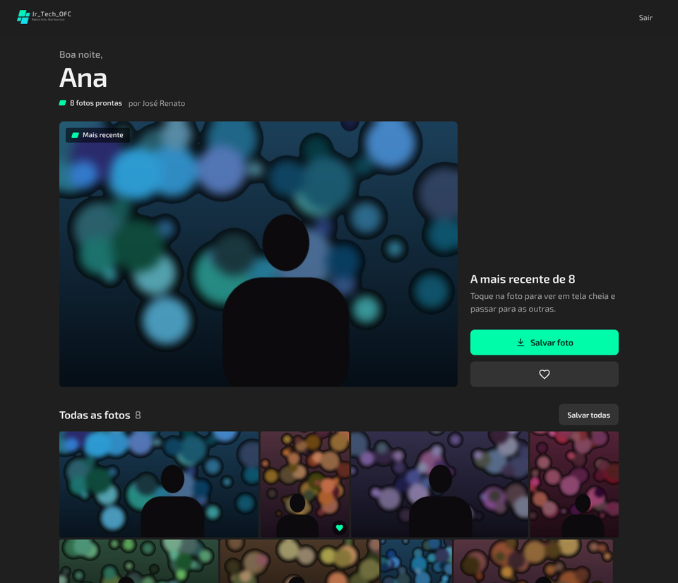</p>

1. **Ajustes → Entrega local:** ligue e escolha a rede.
   - **Wi-Fi Direct:** o app cria a rede `DIRECT-JR-Fotos`, com senha fixa (é o padrão).
   - **Roteador do celular:** você liga o roteador do Android com o mesmo nome e senha.
   - **Wi-Fi do local:** o celular e os clientes ficam no mesmo Wi-Fi.
2. Na aba **Entrega**, toque em **Iniciar entrega**. Aparecem dois QR: **① Entrar no Wi-Fi** e **② Abrir as fotos**. Em **Placa para imprimir**, gere o PNG e o PDF A6 para deixar na mesa.
3. **Novo cliente:** cada um ganha um código de 4 números e um QR próprio. No modo automático, as fotos novas vão para o cliente da vez.
4. O cliente salva cada foto (ou todas) e marca favoritas, que aparecem na galeria e no culling.
5. **Encerrar acesso** invalida o código; **Parar** desliga a rede.

A página do cliente abre com o símbolo da Jr_Tech_OFC se montando, e cada número do código acende um bloco do logo. Se o celular do cliente avisar que o Wi-Fi não tem internet, ele toca em **Manter conectado**.
</details>

<details>
<summary><b>⚡ Fotografia Express e Pix</b></summary>

<p> 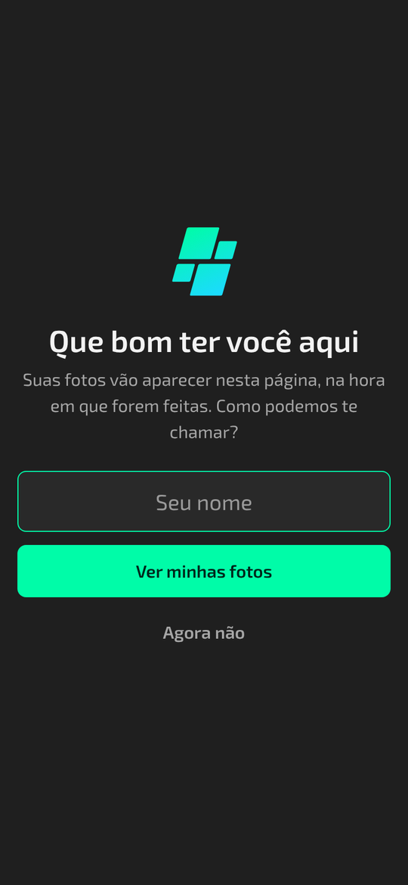  </p>

Fotografar e entregar na hora, um cliente por vez, **sem código**:
1. Na aba **Express**, toque em **Ligar a Fotografia Express** e depois em **Iniciar entrega**.
2. O cliente entra no Wi-Fi pelo QR ① e abre as fotos pelo QR ②. A página pergunta o nome dele.
3. No **Modo prévia**, ele vê as fotos com marca d'água, marca as favoritas com o coração e você recebe "Ana gostou de uma foto".
4. Com **Ajustes → Pagamentos** preenchido, o botão **Pagar** mostra o Pix Copia e Cola com o **valor exato**, montado no próprio celular.
5. Depois do pagamento, toque em **Liberar** (ou **Liberar favoritas** / **Liberar todas**): no celular do cliente, as fotos ficam limpas e aparece **Salvar foto**.
6. **Finalizar e limpar para o próximo cliente** encerra o atendimento e deixa o portal vazio.

**Pagamentos** (Ajustes → Pagamentos):
- **Pix:** chave, tipo, nome de quem recebe e cidade;
- **Valores:** por foto, pacote e "todas as fotos";
- **Formas aceitas e observação** para o cliente.

O app sempre cobra o preço mais barato para o cliente, e **Testar** confere o QR no app do seu banco.

**Versões da mesma foto:** no visualizador, **Versões** manda a mesma foto com outros presets (ex.: `Ana_IMG_1234_v2_Preto-e-branco.jpg`), cada uma com o nome do visual na página do cliente.
</details>

<details>
<summary><b>💬 WhatsApp, recorte e mensagens</b></summary>

- **Recortar:** no visualizador, toque no ícone de recorte e escolha a proporção (Instagram 4:5, Stories 9:16, 10×15…). **Endireitar** funciona com a régua, com o **Auto** ou com **Traçar horizonte**. O arquivo original não muda.
- **Recorte rápido:** na galeria, segure para selecionar várias fotos → **Recorte** → formato.
- **WhatsApp direto:**
  1. Coloque o nome e o número com DDD.
  2. **Abrir conversa** abre o chat já com a mensagem automática; envie a mensagem.
  3. Volte ao app e toque em **Enviar fotos**: elas vão para a mesma conversa.
- **Mensagens prontas** (Ajustes → Mensagens): cada uma tem um atalho (`fotos`, `ent`, `pix`, `agenda`…). Digite o atalho e o texto vem com o nome do cliente e a data.
</details>

<details>
<summary><b>📱 Posição da tela e modo cliente</b></summary>

- O botão de girar abre o dial de posição: **Em pé**, **Direita**, **Invertido**, **Esquerda** ou **Automático**. Vale para o app inteiro, e a tela nunca gira por causa da foto.
- **Foto acompanha o celular** (ligado por padrão): numa posição fixa, só a foto gira quando você vira o celular.
- Deitado, cada tela põe a foto à esquerda e os controles à direita.
- **Modo cliente:**
  - tela cheia com zoom e PIN para sair;
  - **Fixar a tela**: os botões do Android não tiram o cliente do app;
  - resumo ao fim da sessão.

<p>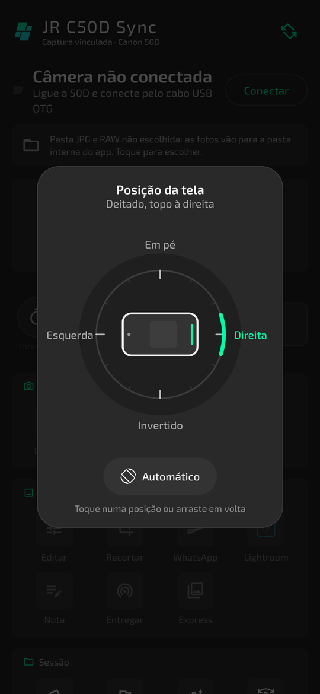 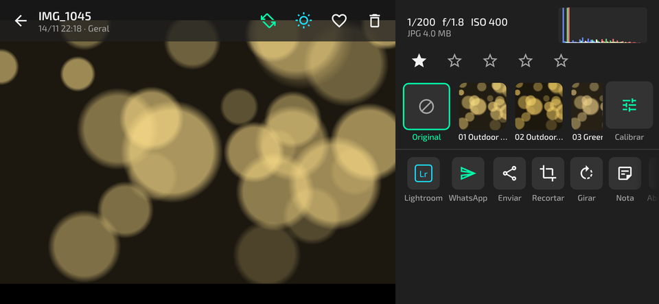</p>
</details>

<details>
<summary><b>🗂 Perfis, backup, log e modo desenvolvedor</b></summary>

- **Perfis:** sets prontos (Casamento / igreja, Ensaio externo, Evento / festa, Estúdio / produto) ou o seu. O chip **Perfil**, na Sessão, troca tudo de uma vez.
- **Backup dos ajustes:** um `.json` com ajustes, perfis e presets. Senhas, PIN, chave Pix e contatos só entram com **Incluir senhas e chave Pix**.
- **Log:** um arquivo por dia (os últimos 10 dias). Se o app fechar sozinho, **Ajustes → Diagnóstico** mostra como fechou, e **Compartilhar** junta os últimos dias.
- **Modo desenvolvedor:** toque 7 vezes na marca no fim de Ajustes para ver:
  - teste de foco e disparo;
  - propriedades da câmera;
  - log USB;
  - foto simulada;
  - render pela CPU;
  - exportar o banco.
- **Abertura:** a animação da marca dura menos de 3 s e um toque pula. Em **Ajustes → Tela → Abertura** dá para desligar ou tocar em **Ver agora**. Vídeo: [`docs/intro/abertura_jr_c50d_sync.mp4`](docs/intro/abertura_jr_c50d_sync.mp4).
</details>

<details>
<summary><b>🩺 Se algo der errado</b></summary>

| Sintoma | O que fazer |
|---|---|
| "Câmera não conectada" | Confira se a 50D está ligada e se o cabo é OTG. Toque em **Conectar**. |
| "Permissão USB negada" | Toque em **Conectar** e depois em **Permitir**. |
| Foto não chega | O formato em Ajustes precisa incluir o que a câmera grava (câmera em RAW e app em "Só JPG" não baixa nada). |
| Não dispara pelo app | AF sem foco. Use MF ou AF-ON. |
| Live view não aparece | Ative o Disparo com Live View na 50D e use P, Tv, Av ou M. |
| WhatsApp abre "Enviar para" | Use primeiro **Abrir conversa** e mande a mensagem; depois **Enviar fotos**. |
| Preset não importa | O arquivo precisa ter ajustes do Lightroom (DNG de foto comum não tem). |
| App fechou sozinho | **Ajustes → Diagnóstico** diz como fechou; **Compartilhar** manda o log. |
</details>

## Para desenvolver

<details>
<summary><b>Compilar, testar e publicar</b></summary>

Precisa de **JDK 17** e do **Android SDK** (ou do Android Studio, que traz os dois).

```bash
./gradlew :app:assembleDebug          # APK em app/build/outputs/apk/debug/app-debug.apk
./gradlew :app:testDebugUnitTest      # testes (PTP, presets, processamento, entrega, banco)
```

**Nova versão:**
1. Suba o `versionName` em `app/build.gradle.kts`.
2. Anote as mudanças no `CHANGELOG.md`.
3. Coloque o APK em `release/`.

Quando isso chega na `main`, o GitHub Actions compila, testa, cria a tag `vX.Y` e publica a Release. Os APKs de debug são assinados com `app/signing/jrlink-debug.keystore`, por isso cada versão instala por cima da anterior.
</details>

<details>
<summary><b>Estrutura do código</b></summary>

```
app/src/main/java/com/example/
├── TetherApp.kt                   cria as peças do app (câmera, banco, configurações)
├── MainActivity.kt                navegação por abas e avisos com Desfazer
├── core/
│   ├── ptp/                       protocolo PTP da Canon: pacotes, sessão USB, eventos, valores
│   ├── camera/                    conexão com a 50D, eventos, disparo, exposição, AEB, cartão
│   ├── tether/                    auto-save: baixa cada foto nova e grava na pasta certa
│   ├── storage/                   pastas escolhidas e preview extraído do CR2
│   ├── data/                      banco de fotos (Room), configurações e presets (DataStore)
│   ├── preset/  render/           presets do Lightroom e processamento (GPU, com reserva na CPU)
│   ├── analysis/  live/           histograma, peaking, seleção local e live view
│   ├── delivery/                  entrega local e Express: Wi-Fi, servidor e páginas do cliente
│   ├── messages/  export/         WhatsApp, JPG leve e marca d'água
│   └── service/  alerts/          conexão com a tela apagada e avisos
└── ui/                            telas em Jetpack Compose
app/src/main/assets/               páginas do cliente (portal, express, shared) e marcas d'água
```
</details>

<details>
<summary><b>Onde personalizar</b></summary>

| Quero mudar… | Onde |
|---|---|
| Cores da marca e do tema | `ui/theme/Theme.kt` → `Brand`, `DayPalette`, `NightPalette` |
| Padrões das opções | `core/data/AppSettings.kt` → `Settings` |
| Páginas do cliente | `app/src/main/assets/shared/brand.css` (cores) e `portal/`, `express/` |
| Logos da marca d'água | `app/src/main/assets/watermarks/` (gerados por `branding/render.py`) |
| Ícone do app e banner deste README | `branding/icon.py` e `branding/banner.py` |
| Presets que vêm com o app | `core/preset/StarterPresets.kt` |
| Mensagens padrão do WhatsApp | `core/messages/MessageTemplates.kt` (ou em Ajustes → Mensagens) |
| Flashes da calculadora | `core/tools/FieldMath.kt` → `Flash` |
| Proporções do recorte | `core/render/Crop.kt` → `CropRatio` |
</details>

**Identidade visual:** [`DESIGN.md`](DESIGN.md) e [`branding/`](branding/). **Histórico de versões:** [`CHANGELOG.md`](CHANGELOG.md).

---

<p align="center">
  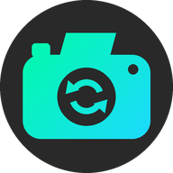<br>
  <b>JR C50D Sync</b> · um app da <b>Jr_Tech_OFC</b> (<a href="https://instagram.com/jose_renato_a">@jose_renato_a</a>)<br>
  <sub>Projeto pessoal, uso exclusivo. Marca, logo e nome Jr_Tech_OFC: todos os direitos reservados.<br>
  Fonte <a href="https://github.com/googlefonts/Exo-2.0">Exo 2</a> (SIL OFL). Protocolo PTP com base no <a href="https://github.com/gphoto/libgphoto2">libgphoto2</a>.</sub><br><br>
  <i>Nossa Arte, Seu Sucesso</i>
</p>
