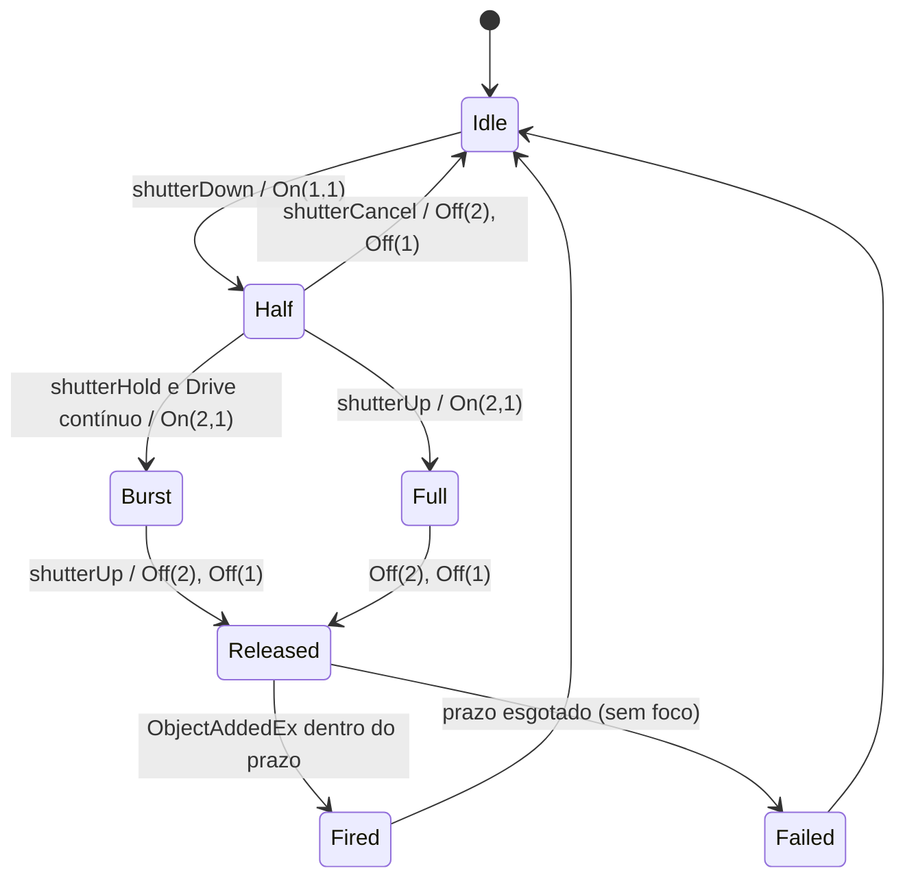

# Correção do disparo remoto — Canon-50D-Remote × app de referência

> Data: 2026-11-20 · Repositório analisado: `jrtechofcdev/Canon-50D-Remote` (commit `c3bd775`, "JR C50D Sync 5.1")
> Referência: "Camera Connect & Control" 7.0.8 (Rupiapps), que dispara corretamente na sua 50D.
> Da referência foram observados **apenas os comandos PTP enviados e seus parâmetros**. Nenhum código foi copiado. Os trechos Kotlin abaixo são propostas novas, escritas para o seu projeto.
> Nenhum arquivo do repositório foi alterado.

---

## 1. Resumo

O seu projeto já tem uma base boa. A sessão PTP é serializada (`Mutex` em `PtpSession`), há reset de USB, laço de eventos, `AfCancel` antes do disparo, pausa do Live View (`liveHold`) e reconexão. **O problema está na forma de apertar o botão do obturador**, não no transporte.

| | Seu app | App de referência |
|---|---|---|
| Comando preferido | `0x910F RemoteRelease` (disparo de uma vez) | `0x9128 RemoteReleaseOn` / `0x9129 RemoteReleaseOff` |
| Quando usa o outro | `0x9128` só se a câmera **não** tiver `0x910F` | `0x910F` só se a câmera **não** tiver `0x9128` |
| Como aperta | Repete `0x910F` a cada 300 ms até a câmera aceitar | Meio curso → curso completo → solta o completo → solta o meio, como um dedo no botão |
| Parâmetros do On/Off | `On(3, 0)` e depois `Off(3)` | `On(1, 1)` → `On(2, 1)` → `Off(2)` → `Off(1)` |
| Foco | Cada nova tentativa do `0x910F` refaz o AF; com "focar antes", ainda roda `DoAf` separado | O meio curso faz o AF uma vez só |
| Botão na tela | Só clique (`clickable`) | Pressionar / segurar / soltar / cancelar |
| Segurar para rajada | Não existe | Usa o Drive Mode (`0xD106`) para decidir |

**Correção principal:** preferir `0x9128`/`0x9129` quando a 50D anunciar esses comandos, com a sequência em etapas da seção 3, e deixar `0x910F` só como reserva.

---

## 2. Diferenças encontradas, com local no código

### D1 — Prioridade dos comandos invertida (causa principal)

**Onde:** `app/src/main/java/com/example/core/camera/CameraManager.kt:459`

```kotlin
info.supports(PtpOp.EOS_REMOTE_RELEASE),   // true na 50D → sempre 0x910F
```

e `core/camera/ShutterRelease.kt:70-76`.

**O que acontece:** a 50D anuncia `0x910F`, então o app **nunca** usa o par On/Off. O `0x910F` faz "focar + disparar" num único comando. Se o AF não trava naquele instante, a câmera responde OK com o parâmetro 1 ("sem foco") e nada acontece. O seu laço repete o comando a cada 300 ms, e **cada repetição recomeça o AF do zero**. É por isso que aparece "Focando… 10 s" e que fotos se perdem. O comentário em `ShutterRelease.kt:52-53` já registra esse efeito.

**Na referência:** o app pergunta primeiro se a câmera tem `0x9128`. Se tiver, usa o par On/Off e só cai no `0x910F` se `0x9128` não existir.

**Correção:** inverter a escolha (seção 3.1).

> Confirme na sua câmera: com o Modo desenvolvedor ligado, registre se o `GetDeviceInfo` da 50D lista `0x9128` e `0x9129` (teste T1 da seção 5). Como a referência funciona na sua 50D e prefere `0x9128`, o esperado é que a lista contenha esses comandos.

### D2 — Parâmetros e sequência do On/Off

**Onde:** `ShutterRelease.kt:73-74`

```kotlin
ptp.transact(PtpOp.EOS_REMOTE_RELEASE_ON, 3, 0)
ptp.transact(PtpOp.EOS_REMOTE_RELEASE_OFF, 3)
```

**Problemas:**
- `3` aperta o meio curso e o curso completo de uma vez, sem dar tempo ao AF.
- O `Off` vem logo em seguida. Se a câmera ainda está focando, o botão é "solto" antes da foto.
- O 2º parâmetro `0` não é o valor que a referência usa.

**Na referência:**

| Ação | Comando enviado |
|---|---|
| Meio curso (foco) | `0x9128` com `(1, 1)` |
| Curso completo (disparo) | `0x9128` com `(2, 1)` (há um caminho com `(2, 2)`, ligado ao modo de segurar) |
| Soltar curso completo | `0x9129` com `(2)` |
| Soltar meio curso | `0x9129` com `(1)` |

A Canon não documenta publicamente o significado exato do 2º parâmetro. Use `1`, que é o valor da referência que funciona na sua câmera, e compare com `0` no teste T3.

### D3 — O "soltar" não é garantido

**Onde:** `ShutterRelease.kt:73-74` dentro do `try` de `ShutterRelease.kt:71-100`.

Se o `On(3,0)` responder `0x2019 DeviceBusy`, a exceção cai no `catch` (`ShutterRelease.kt:88`) e o laço manda **outro On sem nunca ter mandado o Off**. Botão virtual "preso" deixa a câmera respondendo busy nas tentativas seguintes. É o mesmo sintoma que o seu `onStuck` tenta remediar.

**Correção:** `Off(2)` e `Off(1)` sempre num `finally`, ignorando erros (seção 3.2).

### D4 — Foco feito duas vezes no Live View

**Onde:** `CameraManager.kt:419-429` (com `focusFirst`) e `CameraManager.kt:478-489`

Com "focar antes" ligado, a sequência é `DoAf` → espera fixa de 1,2 s ou 2,8 s (`AF_WAIT_*`) → `AfCancel` → `0x910F`, que **foca de novo**. No modo rápido (Quick AF), isso faz o espelho descer duas vezes.

**Na referência:** o meio curso (`On(1,1)`) é o foco. Não há `DoAf` antes do disparo.

**Correção:** com On/Off, retire o `runAf` do caminho do disparo. O `DoAf` continua útil no botão "Focar" separado (`liveAutofocus`). Mantenha o `cancelAf` antes do disparo (`CameraManager.kt:424`): ele fecha um AF de toque que tenha ficado aberto, e isso está certo.

### D5 — Botão da tela é só "clique"

**Onde:** `ui/live/LiveViewScreen.kt:203` e `:434` (`.clickable(...)`). Também `ui/session/SessionScreen.kt:266` e `ui/settings/DeveloperScreen.kt:70` chamam `capture()`.

O `clickable` só dispara quando o dedo sobe. Com isso não existe meio curso enquanto o dedo está na tela, não existe "segurar para rajada" e não dá para cancelar arrastando para fora.

**Na referência:** o botão gera os eventos *down*, *hold start*, *hold stop* e *cancel*. Ao segurar, o app lê o **Drive Mode (`0xD106`)**. Nos modos contínuos (a referência testa os valores `1`, `4`, `0x12`, `0x14` e `5`), ele mantém o curso completo pressionado até o dedo sair. Nos outros modos, faz uma foto só.

**Correção:** seção 3.3. Adicione `DRIVE_MODE = 0xD106` em `PtpConstants.kt` (o laço de eventos já recebe o valor via `PropValueChanged`).

### D6 — Confirmação de "disparou"

**Onde:** `CameraManager.kt:435` marca `Fired` assim que o comando responde OK.

Com On/Off, "OK" quer dizer só "botão apertado". A prova de que a foto existe é o evento `ObjectAddedEx` (`0xC181`), que o seu `eventLoop` já recebe e publica em `newObjects`.

**Correção:** depois do `On(2)`, espere `newObjects.first()` com um limite de tempo, como o `startBracket` já faz em `CameraManager.kt:787-791`. Se o limite passar sem foto, mostre "não focou / não disparou".

### O que está certo e deve ficar

- `PtpSession`: `Mutex`, conferência do transactionId, `isBroken`, `recover()`.
- `liveHold`, que pausa o Live View durante o disparo, e o `LIVE_AFTER_SHOT_MS`.
- `shotLock` entre botão, intervalômetro e bracketing.
- `cancelAf` antes do disparo e ao sair do Live View.
- Leitura inicial de eventos, destino = cartão, keep-alive e reconexão.

---

## 3. Correção proposta

### 3.1 Escolha do método (inverter a prioridade)

```kotlin
// PtpConstants.kt
object EosProp { /* ... */ const val DRIVE_MODE = 0xD106 }

// ShutterRelease.kt
enum class ReleaseMethod { PRESS_RELEASE, LEGACY, NONE }

fun methodFor(info: DeviceInfo) = when {
    info.supports(PtpOp.EOS_REMOTE_RELEASE_ON) && info.supports(PtpOp.EOS_REMOTE_RELEASE_OFF) -> ReleaseMethod.PRESS_RELEASE
    info.supports(PtpOp.EOS_REMOTE_RELEASE) -> ReleaseMethod.LEGACY   // o fire() atual continua aqui
    else -> ReleaseMethod.NONE
}
```

Registre o método escolhido no log ao conectar (`runSession`, depois de `CameraManager.kt:305`).

### 3.2 Sequência em etapas, com "soltar" garantido

```kotlin
object ShutterButton {
    const val HALF = 1
    const val FULL = 2
    const val FLAG = 1          // 2º parâmetro usado pela referência

    /** Aperta um nível, repetindo enquanto a câmera responde busy/not ready. */
    suspend fun press(ptp: PtpSession, level: Int, timeoutMs: Long = 3_000) {
        val start = System.currentTimeMillis()
        while (true) {
            try { ptp.transact(PtpOp.EOS_REMOTE_RELEASE_ON, level, FLAG); return }
            catch (e: PtpResponseException) {
                val retry = e.code == PtpResponse.DEVICE_BUSY || e.code == PtpResponse.NOT_READY
                if (!retry || System.currentTimeMillis() - start > timeoutMs) throw e
                delay(100)
            }
        }
    }

    /** Solta tudo. Nunca lança exceção: deve rodar em qualquer saída. */
    suspend fun releaseAll(ptp: PtpSession) {
        runCatching { ptp.transact(PtpOp.EOS_REMOTE_RELEASE_OFF, FULL, timeoutMs = 2_000) }
        runCatching { ptp.transact(PtpOp.EOS_REMOTE_RELEASE_OFF, HALF, timeoutMs = 2_000) }
    }

    /** Toque simples: meio curso → completo → solta → espera a foto aparecer. */
    suspend fun singleShot(ptp: PtpSession, photoArrived: suspend (Long) -> Boolean, waitMs: Long): Boolean {
        try {
            press(ptp, HALF)          // a câmera foca aqui (1 vez)
            press(ptp, FULL)          // em One-Shot AF, a câmera só dispara se focou
        } finally {
            releaseAll(ptp)           // D3: sempre
        }
        return photoArrived(waitMs)   // D6: confirma pelo ObjectAddedEx
    }
}
```

No `CameraManager.capture()` (`CameraManager.kt:415-448`), dentro do `shotLock` e com `liveHold = true`:

```kotlin
val arrived = scope.async(start = CoroutineStart.UNDISPATCHED) {   // assinar ANTES de disparar
    withTimeoutOrNull(waitMs) { newObjects.first() } != null
}
when (methodFor(info)) {
    ReleaseMethod.PRESS_RELEASE -> {
        if (inLive) cancelAf(ptp, "antes do disparo")           // mantém
        // sem runAf aqui (D4)
        ShutterButton.singleShot(ptp, { arrived.await() }, wait)
            .let { if (!it) throw PtpException("A câmera não disparou (sem foco?)") }
    }
    ReleaseMethod.LEGACY -> fireLogged(ptp, info, wait, inLive)  // caminho atual, intacto
    ReleaseMethod.NONE -> throw PtpException("Esta câmera não aceita disparo pelo cabo")
}
```

> Faça o mesmo em `fireLogged`, que o intervalômetro e o bracketing usam (`CameraManager.kt:790` e `:870`).

### 3.3 Botão com pressionar / segurar / soltar

Nova API no `CameraManager`, usada pelo botão:

```kotlin
fun shutterDown()     // dedo encostou → press(HALF)          (foco começa já)
fun shutterUp()       // dedo saiu      → press(FULL) + releaseAll  (foto única)
fun shutterHold()     // segurou > 400 ms e Drive contínuo → press(FULL) e mantém (rajada)
fun shutterCancel()   // arrastou para fora → releaseAll, sem foto
```

Regras:
- Todas passam pelo `shotLock` e ligam `liveHold` enquanto houver nível pressionado.
- Se o Drive Mode não for contínuo, o *hold* não faz nada: a foto sai no `shutterUp`.
- Se a conexão cair com o botão pressionado, `closeSession` não consegue mais mandar o Off. Por isso, ao reconectar, mande `releaseAll` logo depois do `SetEventMode` (`CameraManager.kt:310`).

No Compose, troque o `.clickable` (`LiveViewScreen.kt:434`) por `pointerInput` + `awaitEachGesture`. O `LiveViewScreen.kt:541-542` já usa `detectTapGestures(onPress = …)` para outra área, e o mesmo padrão serve aqui: `onPress` chama `shutterDown`, `tryAwaitRelease()` devolve se o dedo subiu dentro (`shutterUp`) ou foi cancelado (`shutterCancel`), e um temporizador de 400 ms chama `shutterHold`.

`capture()` continua existindo para a tela de Sessão, o Desenvolvedor e o intervalômetro: ele chama `singleShot`.

### 3.4 Estados



---

## 4. Ordem de implementação

1. **T1 primeiro**: logar se a 50D anuncia `0x9128`/`0x9129`. Sem isso, nada muda.
2. `DRIVE_MODE` em `PtpConstants.kt` e `methodFor()` em `ShutterRelease.kt`.
3. Objeto `ShutterButton` (`press`, `releaseAll`, `singleShot`).
4. `capture()` e `fireLogged()` usando o novo método. O `fire()` atual vira só o caminho `LEGACY`.
5. Remover o `runAf` do caminho do disparo quando o método for `PRESS_RELEASE` (a opção "focar antes" deixa de ser necessária nesse caso).
6. API `shutterDown/Up/Hold/Cancel` e o botão com `pointerInput`.
7. `releaseAll` depois do handshake de reconexão.

---

## 5. Testes na 50D

| # | Teste | Esperado |
|---|---|---|
| T1 | Conectar com Modo desenvolvedor; ver no log a lista de operações | Contém `0x9128` e `0x9129` → método `PRESS_RELEASE` |
| T2 | 50 toques simples, fora do Live View, lente em AF, alvo com contraste | 50 fotos, nenhuma "Focando… > 2 s" |
| T3 | Repetir o T2 com o 2º parâmetro `0` em vez de `1` | Registrar a diferença; manter o valor que der 50/50 |
| T4 | 50 toques no Live View, AF Quick e depois AF Live | Espelho desce **uma** vez por foto; LV volta em < 1 s |
| T5 | Lente com tampa (AF impossível) | "Não disparou (sem foco)" em ≤ prazo; o próximo disparo funciona normalmente |
| T6 | Lente em MF | Dispara na hora |
| T7 | Drive contínuo; segurar 3 s | Rajada; para ao soltar; sem câmera presa |
| T8 | Arrastar o dedo para fora do botão | Nenhuma foto; câmera livre |
| T9 | Puxar o cabo com o botão segurado; reconectar | Câmera não fica "busy"; primeiro disparo após reconectar funciona |
| T10 | Intervalômetro 100 × 3 s com Live View aberto | 100 fotos; nenhum `onStuck` no log |

---

## 6. Limitações desta análise

- Nenhum teste foi feito na sua 50D. O ponto D1 depende de o T1 confirmar o suporte a `0x9128`.
- O significado do 2º parâmetro do `RemoteReleaseOn` não é documentado publicamente. Os valores vêm do que a referência envia.
- Não foi observado como a referência espera entre o meio curso e o curso completo num toque rápido. A proposta (enviar o completo logo após a resposta do meio curso e confirmar pela chegada da foto) precisa do T2/T4.
- O Live View do seu app (`runLiveView`) não mostrou divergência relevante para o disparo e não foi alterado nesta proposta.
