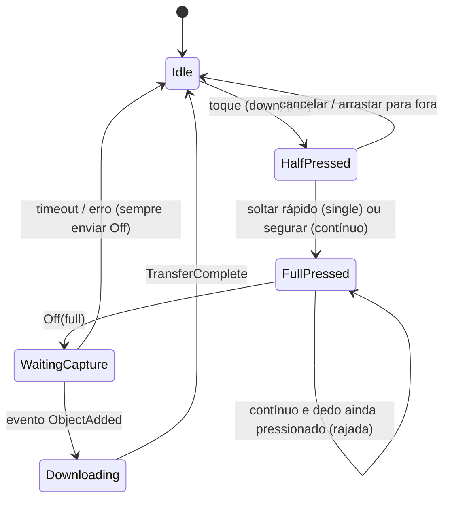
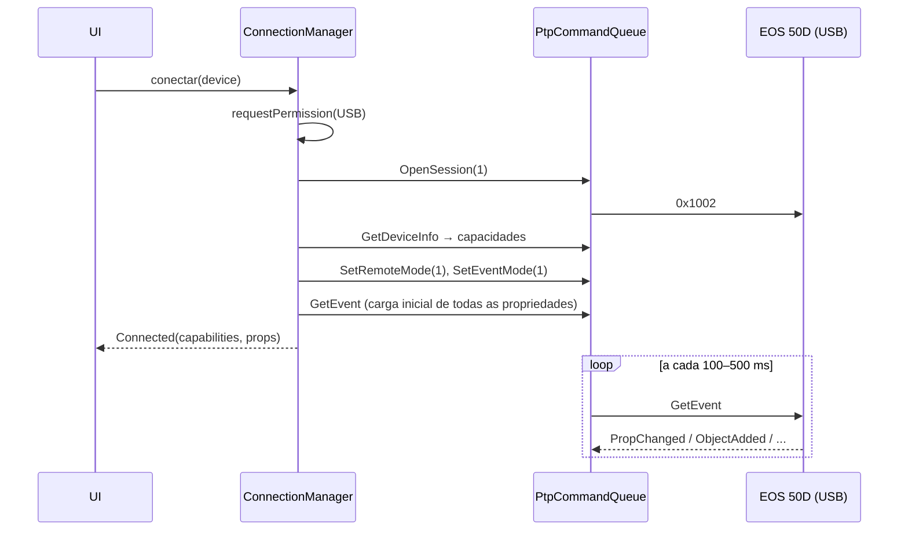
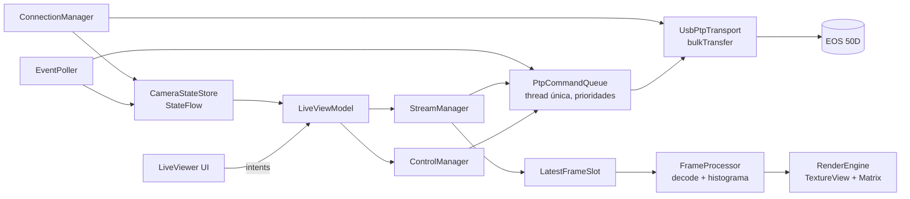

# Live Viewer + Disparo Remoto — Canon EOS 50D
### Análise do que é usado e especificação para implementação própria

> Data: 2026-11-20 · Escopo: entender **quais protocolos, comandos e padrões** são usados para Live View e disparo remoto em câmeras Canon EOS (com foco na 50D), para reimplementação independente.
> Nenhum código foi copiado. As referências ao app analisado são apenas de **quais comandos de protocolo** ele envia e **em que ordem lógica** — informação de interoperabilidade, que também está documentada publicamente (libgphoto2, EDSDK).

---

## 1. Resumo executivo

1. **O Canon Camera Connect (app oficial) não suporta a EOS 50D.** Ele só funciona com câmeras com Wi‑Fi/Bluetooth embutido. A 50D só se comunica por **USB**, com o protocolo **PTP (ISO 15740) + extensões "EOS" da Canon**. (A transmissão sem fio só existe com o acessório WFT‑E3.)
2. O app presente nesta pasta (`com.rupiapps.cameraconnectcast`, "Camera Connect & Control" 7.0.8) é de terceiros. Ele fala com a câmera usando **Android USB Host API** (`UsbDeviceConnection.bulkTransfer`) e **PTP com os opcodes EOS da Canon** — exatamente o mesmo conjunto que o libgphoto2 documenta.
3. **Como o disparo é feito (o ponto que está falhando no seu app):**
   - O app **pergunta à câmera quais comandos ela suporta** (lista de operações do `GetDeviceInfo`) e escolhe:
     - `0x9128 RemoteReleaseOn` / `0x9129 RemoteReleaseOff` (pressionar/soltar o botão do obturador, meio curso e curso completo) **se disponível**;
     - senão, `0x910F RemoteRelease` (disparo "de uma vez", modelos antigos).
   - O botão de disparo da interface é tratado como **um botão físico com estados**: *down*, *hold start*, *hold stop*, *cancel* — não como um simples "clique".
   - Enquanto o botão é mantido, o comportamento depende do **modo de avanço (Drive Mode, propriedade `0xD106`)**: em modo contínuo o app mantém o obturador pressionado (rajada); em quadro único, faz press + release.
   - Todos os comandos passam por **uma única fila serializada** (um comando PTP por vez), e o Live View é pausado/retomado em torno do disparo.
4. As causas mais prováveis de "disparo que não corre bem" em implementações próprias estão na **seção 6.4** (comandos concorrentes com o Live View, falta de `RemoteReleaseOff`, não consumir eventos, buffer da câmera cheio, AF falhando).

### Grau de confiança usado neste documento

| Marca | Significado |
|---|---|
| **[A] Alta** | Documentado publicamente (libgphoto2/EDSDK/manual) **e** observado nos opcodes usados pelo app analisado |
| **[M] Média** | Documentado publicamente, mas não confirmado especificamente na 50D |
| **[B] Baixa / verificar** | Inferência; precisa de teste na câmera real |

---

## 2. Metodologia

| Fonte | O que foi feito |
|---|---|
| App de terceiros (pasta atual) | Busca **apenas** por constantes de opcodes PTP conhecidos e pelas APIs Android usadas (USB Host). Nenhuma lógica foi transcrita. Credenciais em `assets/` **não foram abertas**. |
| libgphoto2 (`camlibs/ptp2/ptp.h`, `library.c`, `config.c`) | Referência pública dos opcodes EOS, códigos de evento e sequências de captura/Live View. |
| Canon EDSDK (documentação) | Modelo conceitual: propriedades EVF, `kEdsCameraCommand_PressShutterButton`, histogram, zoom. |
| Manual EOS 50D | Limites do Live View (modos de AF, ampliação 5×/10×, Silent Shooting). |
| Canon Camera Connect | **Não foi executado nem teve tráfego capturado.** Só a experiência de uso pública serve de referência. Nada sobre a arquitetura interna dele é afirmado aqui. |

**Limitação:** nenhum teste foi feito em uma 50D real nesta investigação. Os itens [M]/[B] devem ser validados com o plano de testes da seção 11.

---

## 3. O que o app analisado usa (inventário técnico)

| Camada | Tecnologia identificada | Confiança |
|---|---|---|
| Transporte USB | Android USB Host API: `UsbManager`, `UsbDeviceConnection.bulkTransfer`, intent `USB_DEVICE_ATTACHED` | [A] |
| Protocolo | PTP (container: comando/dados/resposta) + extensões Canon EOS | [A] |
| Verificação de capacidade | Consulta "operação suportada?" antes de cada recurso (baseada no `GetDeviceInfo`) | [A] |
| Disparo | `0x9128`/`0x9129` (preferencial), `0x910F` (fallback) | [A] |
| Live View | `0x9153 GetViewFinderData` (sem `0x9151/0x9152`, ou seja, ativação via propriedades EVF) | [A] |
| Foco no LV | `0x9154 DoAf`, `0x9160 AfCancel`, `0x9155 DriveLens` (foco manual em passos) | [A] |
| Sessão remota | `0x9114 SetRemoteMode`, `0x9115 SetEventMode`, `0x9116 GetEvent` (polling de eventos) | [A] |
| Propriedades | `0x9110 SetDevicePropValueEx` | [A] |
| Download | `0x100E` e operações de objeto PTP padrão | [M] |
| Concorrência | Fila de comandos serializada + `Handler`/`Runnable` para temporizações da UI | [A] |
| Stack | Kotlin, coroutines, AndroidX, NanoHTTPD (servidor HTTP embutido, provavelmente para "cast"/visualização em outro dispositivo) | [A] |

> Para a sua implementação, **o que importa é a lista de opcodes e a ordem de uso**. Tudo isso está publicamente em `libgphoto2/camlibs/ptp2/ptp.h`.

---

## 4. Protocolo: PTP sobre USB (base de tudo)

### 4.1 Container PTP (USB bulk) — [A]

```
offset  tamanho  campo
0       4        length   (uint32 LE, inclui o cabeçalho de 12 bytes)
4       2        type     (1=Command, 2=Data, 3=Response, 4=Event)
6       2        code     (opcode ou response code)
8       4        transactionId
12      0..20    params   (até 5 × uint32 LE) — ou payload, no container Data
```

Uma **transação** = Command → (Data opcional, em qualquer direção) → Response.
**Regra de ouro: o PTP é estritamente sequencial.** Uma transação precisa terminar antes da próxima começar. Duas threads enviando comandos ao mesmo tempo = respostas trocadas, timeouts e travamentos. **Essa é a causa nº 1 de disparo instável.**

### 4.2 Opcodes relevantes — [A] (libgphoto2)

| Opcode | Nome | Uso |
|---|---|---|
| `0x1001` | GetDeviceInfo | Lista de operações/propriedades/eventos suportados → **detectar capacidades** |
| `0x1002` | OpenSession | Abrir sessão |
| `0x1003` | CloseSession | Fechar sessão |
| `0x9114` | SetRemoteMode(1) | Entrar em modo de controle remoto |
| `0x9115` | SetEventMode(1) | Habilitar fila de eventos EOS |
| `0x9116` | GetEvent | Ler eventos pendentes (polling) |
| `0x9110` | SetDevicePropValueEx | Alterar ISO/Tv/Av/WB/EVF etc. |
| `0x910F` | RemoteRelease | Disparo "legado" (uma operação) |
| `0x9128` | RemoteReleaseOn(p1, p2) | Pressionar botão: p1 = 1 meio curso, 2 curso completo, 3 ambos |
| `0x9129` | RemoteReleaseOff(p1) | Soltar botão (mesmo p1) |
| `0x9153` | GetViewFinderData(0x00100000) | Pegar 1 quadro do Live View |
| `0x9154` | DoAf | AF no Live View |
| `0x9160` | AfCancel | Cancelar AF |
| `0x9155` | DriveLens(step) | Foco manual (passos perto/longe) |
| `0x9117` | TransferComplete | Liberar o objeto do buffer após download |

O segundo parâmetro de `0x9128` (comportamento do AF ao pressionar) varia entre modelos: no libgphoto2, 0 = com AF. **[M] — teste na 50D.**

### 4.3 Propriedades EOS (`0xD1xx`) — [A]/[M]

| Código | Propriedade | Observação |
|---|---|---|
| `0xD101` | Aperture (Av) | valores codificados pela Canon (tabela no libgphoto2) |
| `0xD102` | ShutterSpeed (Tv) | idem |
| `0xD103` | ISO | idem |
| `0xD104` | ExposureCompensation | |
| `0xD105` | AutoExposureMode | P/Tv/Av/M… **lido do dial; não pode ser mudado remotamente** |
| `0xD106` | DriveMode | single/contínuo/timer — **o app usa para decidir o comportamento do "segurar"** |
| `0xD108` | FocusMode | AF/MF — **chave física na lente; só leitura** |
| `0xD109` | WhiteBalance | |
| `0xD11C` | CaptureDestination | cartão × RAM/host — veja 6.4 |
| `0xD1B0` | EVFOutputDevice | **2 = PC** liga o LV remoto; 0/1 desliga/volta pro LCD |
| `0xD1B1` | EVFMode | 1 = habilitado |

### 4.4 Eventos (resposta do `0x9116 GetEvent`) — [A]

O payload é uma sequência de registros `[uint32 size][uint32 type][dados…]`, terminada por um registro de tipo 0.

| Tipo | Significado | Ação |
|---|---|---|
| `0xC189` | PropValueChanged | atualizar ISO/Tv/Av… na UI |
| `0xC18A` | AvailListChanged | atualizar as listas de valores permitidos |
| `0xC181` / `0xC1A7` | ObjectAddedEx (32/64 bits) | **foto pronta** → baixar (se destino = host) |
| `0xC186` | RequestObjectTransfer | a câmera pede que o host baixe o objeto |
| `0xC18B` | CameraStatusChanged | ocupada/livre |

A câmera **não envia nada sozinha**: se o app não chamar `GetEvent`, ele nunca saberá que a foto terminou nem que um valor mudou no dial.

---

## 5. Live View na EOS 50D

### 5.1 Capacidades — com confiança

| Recurso | 50D | Confiança |
|---|---|---|
| Live View remoto por USB | Sim (suportado pelo EOS Utility na época) | [A] |
| Wi‑Fi nativo / Camera Connect / CCAPI | **Não** | [A] |
| Formato do quadro | JPEG dentro do payload do `0x9153` | [A] |
| Resolução do quadro | Na faixa de ~800–1000 px de largura; **meça em tempo de execução** | [B] |
| FPS | Depende do USB 2.0 e do celular; espere algo entre ~10 e 30 | [B] |
| Ampliação 5×/10× | Existe na câmera; o controle remoto da posição precisa de teste | [M] |
| AF no LV: Quick / Live / Live com detecção de rosto | Existe (menu da câmera) | [A] |
| Quick AF | **Abaixa o espelho → o LV fica preto durante o AF** | [A] |
| Foco manual remoto (DriveLens) | Provável (exige a chave da lente em AF) | [M] |
| Histograma vindo da câmera | O EDSDK expõe histogram de EVF; em PTP, vem nos blocos extras do payload | [B] — mais seguro calcular a partir do JPEG |
| Touch AF por coordenada | Não existe na 50D (é recurso de modelos mais novos) | [M] |
| Vídeo | **Não** (a 50D não grava vídeo) | [A] |
| Live View precisa estar "Enable" no menu | Possivelmente sim — **verificar** | [B] |

### 5.2 Iniciar e parar

```
startLiveView():
    setProp(0xD1B1 EVFMode, 1)               # se existir
    setProp(0xD1B0 EVFOutputDevice, 2)       # 2 = PC
    aguardar evento PropValueChanged(0xD1B0) ou ~300 ms
    iniciar o laço de quadros

stopLiveView():
    parar o laço
    setProp(0xD1B0, 0)                        # ou o valor salvo antes
```

### 5.3 Laço de quadros

```
loop enquanto lvAtivo:
    r = queue.submit(LOW_PRIORITY, GetViewFinderData(0x00100000))
    se r.code == 0xA102 (NotReady) ou 0x2019 (DeviceBusy):
        sleep(20–50 ms); continue                 # normal, não é erro
    jpeg = extrairBloco(r.data, tipo=1)           # [len][type][bytes]; tipo 1 = JPEG
    se jpeg inválido (sem FFD8…FFD9): descartar; continue
    frameSlot.set(jpeg)                           # slot ÚNICO: sobrescreve o anterior
    a cada N quadros (ex.: 5): GetEvent
```

**Anti-acúmulo:** use um "slot de 1 quadro" (latest-wins), e não uma fila. A decodificação lê sempre o último quadro e ignora os que perdeu. Isso mantém a latência baixa.

**Decodificação/render (Android):** `BitmapFactory.decodeByteArray` com `inBitmap` (reutilizar memória) ou `ImageDecoder` → desenhar em `TextureView`/`SurfaceView` com `Matrix` para fit/zoom. A decodificação fica numa thread separada da thread do USB.

---

## 6. Disparo remoto (o foco do problema)

### 6.1 Seleção do método — [A]

```kotlin
val ops = deviceInfo.operationsSupported
val releaseMethod = when {
    0x9128 in ops && 0x9129 in ops -> ReleaseMethod.PRESS_RELEASE   // On/Off
    0x910F in ops                  -> ReleaseMethod.LEGACY          // RemoteRelease
    else                           -> ReleaseMethod.UNSUPPORTED
}
```

**Não fixe o método no código.** Detecte qual a 50D anuncia e registre no log (isso responde de forma definitiva qual opcode a sua câmera usa).

### 6.2 Botão de disparo como máquina de estados

Esse é o padrão observado no app de referência (eventos *down / holdStart / holdStop / cancel*), descrito aqui de forma independente:



### 6.3 Sequência de disparo (método On/Off)

```
shoot(singleShot):
    queue.pauseLiveView()                       # NÃO concorra com 0x9153
    r = RemoteReleaseOn(1, af)                  # meio curso → AF/medição
    aguardar o AF (poll GetEvent; timeout ~2–3 s)
    r = RemoteReleaseOn(2, af)                  # curso completo → dispara
    se singleShot: RemoteReleaseOff(2)
    ...
    finally:                                    # SEMPRE, mesmo com erro
        RemoteReleaseOff(2)
        RemoteReleaseOff(1)
    aguardar ObjectAddedEx via GetEvent (timeout ~ Tv + 5 s; bulb = sem limite)
    se destino == host: baixar + TransferComplete
    queue.resumeLiveView()                      # na 50D o LV volta após o espelho
```

Modo contínuo (Drive Mode `0xD106` = contínuo): no *holdStart* envie `On(2)` e **só** envie `Off` no *holdStop*/*cancel*. A câmera faz a rajada sozinha.

Método legado (`0x910F`): um único comando. Depois dele, faça o mesmo laço de `GetEvent` para saber quando terminou.

### 6.4 Por que o disparo "não corre bem" — causas típicas

| # | Sintoma | Causa provável | Correção |
|---|---|---|---|
| 1 | Timeout aleatório, resposta "errada", app trava | Thread do LV chamando `0x9153` ao mesmo tempo que o disparo | **Uma fila única de comandos PTP**; o disparo tem prioridade alta e pausa o LV |
| 2 | A câmera fica "travada" depois de um disparo | `RemoteReleaseOn` sem o `Off` correspondente (botão virtual continua pressionado) | `Off(2)` e `Off(1)` em `finally`, inclusive no cancel/erro/desconexão |
| 3 | Dispara uma vez e depois não dispara mais | Destino = RAM/host e o app não baixa as fotos → buffer cheio | Defina `0xD11C` = cartão, **ou** baixe e chame `TransferComplete` para cada `ObjectAdded` |
| 4 | Às vezes não dispara | AF não confirmou foco (One‑Shot AF bloqueia o disparo) | Usar o parâmetro sem AF, MF na lente, ou dar feedback "AF falhou" |
| 5 | `DeviceBusy (0x2019)` | Câmera ainda gravando a foto anterior/processando | Retry com backoff (50→100→200 ms, até ~2 s) |
| 6 | O app não sabe que a foto terminou | Sem polling de `GetEvent` | Polling a cada 100–200 ms durante a captura |
| 7 | O LV fica preto e "trava" após a foto | O app trata `0xA102 NotReady` como erro fatal | `0xA102` é normal após o espelho; continue tentando |
| 8 | Comandos ignorados | Sessão sem `SetRemoteMode(1)`/`SetEventMode(1)` | Fazer o handshake completo (seção 7) |
| 9 | Quick AF no LV: imagem some | O espelho desce durante o AF | Esperado; mostrar "focando…" |

---

## 7. Gerenciamento de conexão



Estados: `Disconnected → PermissionPending → Opening → Ready → LiveView ⇄ Capturing → Error/Reconnecting`.

- **Perda de conexão:** `USB_DEVICE_DETACHED`, `bulkTransfer` retornando -1 ou 3 timeouts seguidos → `Reconnecting`.
- **Reconexão:** fechar a interface, reabrir, refazer o handshake completo e reaplicar o estado do LV.
- **Desconexão voluntária:** parar o LV → `EVFOutputDevice` volta para o LCD → `SetRemoteMode(0)` → `CloseSession` → liberar a interface.
- **Timeouts sugeridos:** comando 5 s; dados de LV 2 s; download proporcional ao tamanho.

---

## 8. Arquitetura proposta (original)



### 8.1 Contratos

```kotlin
interface PtpTransport {
    suspend fun transact(op: Int, params: IntArray = intArrayOf(),
                         dataOut: ByteArray? = null, timeoutMs: Int = 5000): PtpResult
}
data class PtpResult(val code: Int, val params: IntArray, val data: ByteArray?)

enum class Priority { CRITICAL, HIGH, NORMAL, LOW }   // release-off > release > props > LV

interface PtpCommandQueue {                       // ÚNICO ponto de acesso ao transporte
    suspend fun <T> submit(p: Priority, block: suspend PtpTransport.() -> T): T
    fun pauseLowPriority(); fun resumeLowPriority()
}

data class CameraCapabilities(
    val ops: Set<Int>, val props: Set<Int>,
    val release: ReleaseMethod, val canDriveLens: Boolean, val canDoAf: Boolean
)

data class CameraState(
    val iso: PropValue?, val tv: PropValue?, val av: PropValue?, val ev: PropValue?,
    val wb: PropValue?, val drive: Int?, val aeMode: Int?, val busy: Boolean
)
data class PropValue(val raw: Int, val allowed: List<Int>)

sealed interface ShutterEvent { object Down; object HoldStart; object HoldStop; object Cancel }

data class LvStats(val fps: Float, val width: Int, val height: Int, val decodeMs: Float, val bytes: Int)
```

### 8.2 Responsabilidades

| Componente | Responsabilidade |
|---|---|
| UsbPtpTransport | Encontrar os endpoints bulk IN/OUT/interrupt, montar e desmontar containers, controlar o transactionId |
| PtpCommandQueue | Serializar tudo; prioridades; pausar o LV durante o disparo |
| ConnectionManager | Permissão USB, handshake, watchdog e reconexão |
| EventPoller | `GetEvent` periódico → atualiza o `CameraStateStore`, sinaliza `ObjectAdded` |
| StreamManager | Laço de LV, tratamento de `0xA102`, extração do JPEG, estatísticas |
| FrameProcessor | Decodificação com reutilização de bitmap, histograma (subamostrado), zebra |
| RenderEngine | Fit/aspect, pinça, pan, overlays (grade, terços, centro) |
| ControlManager | Máquina de estados do obturador, AF, DriveLens, `SetPropEx` com listas válidas |

---

## 9. Especificação funcional (com classificação para a 50D)

Legenda: ✅ suportado/comprovado · 🟡 possível, não comprovado · ❌ não suportado · ⚙️ depende de configuração

| Recurso | Status | Observação |
|---|---|---|
| LV contínuo | ✅ | `0x9153` |
| Tela cheia / fit / proporção | ✅ | No app (proporção do JPEG ≈ 3:2) |
| Zoom digital (pinça) e pan | ✅ | No app, sobre o JPEG |
| Ampliação 5×/10× na câmera | 🟡 | Mais resolução real para o foco; testar |
| FPS / resolução / latência | ✅ / ✅ / 🟡 | Latência: apenas estimada (tempo de pedido→render) |
| Grade, terços, centro | ✅ | Overlay |
| Histograma | ✅ | Calculado a partir do JPEG (tons do LV, não do RAW) |
| Zebra / alerta de estouro | 🟡 | Só é fiel se a "simulação de exposição" do LV estiver ativa |
| AF (DoAf) | 🟡 | Opcode usado pelo app de referência; testar o modo Quick vs Live |
| Foco manual (DriveLens) | 🟡 ⚙️ | Lente com a chave em AF |
| Seleção de ponto/área de AF por toque | ❌ / 🟡 | Sem touch AF; mover o quadro de zoom pode servir em modo Live |
| Disparo único | ✅ | `0x9128/9129` ou `0x910F` |
| Rajada segurando | 🟡 ⚙️ | Drive Mode contínuo |
| Bulb | 🟡 | `0x9125/0x9126` existem em outros modelos; verificar a 50D |
| ISO / Tv / Av / EV / WB | ✅ ⚙️ | Só os valores permitidos pela lista `AvailList` e pelo modo do dial |
| Modo P/Av/Tv/M remoto | ❌ | Dial físico |
| Vídeo | ❌ | A 50D não grava vídeo |
| Wi‑Fi | ❌ ⚙️ | Só com o WFT‑E3 |

---

## 10. Plano de implementação

| Etapa | Objetivo | Critério de conclusão | Problemas possíveis |
|---|---|---|---|
| 1. Transporte USB | Abrir o device, endpoints, container PTP | `GetDeviceInfo` lido e logado (**salve a lista de ops da 50D**) | Permissão USB, cabo OTG, a câmera precisa estar em "PC connection"/normal |
| 2. Fila + sessão | Fila única, handshake EOS, `GetEvent` | Propriedades atualizam quando se gira o dial | Eventos com formatos variados → parser tolerante (pular tipos desconhecidos) |
| 3. Disparo | Máquina de estados + `finally Off` | 100 disparos seguidos sem travar; cancel funciona | Buffer cheio (destino), AF bloqueando |
| 4. LV recepção | Laço `0x9153` com `0xA102` | 10 min de LV sem vazamento | Formato dos blocos extras |
| 5. Decode/render | Slot latest-wins, `inBitmap` | ≥ 15 fps visíveis, sem GC visível | Bitmap com tamanho diferente no zoom 5×/10× |
| 6. LV + disparo | Pausar/retomar em volta da captura | LV volta em < 1 s depois da foto | `NotReady` prolongado |
| 7. Controles | ISO/Tv/Av/EV/WB/AF/MF | Valores coerentes com o LCD da câmera | Tabelas de codificação Canon |
| 8. Overlays | Grade, histograma, zebra | Custo < 3 ms por quadro | Histograma em thread própria e subamostrado |
| 9. Falhas | Desconexão, reconexão, watchdog | Desconectar o cabo no meio do disparo → estado limpo | Off pendente na reconexão |
| 10. Otimização | Perfil de CPU/memória | Sessão de 1 h estável | Aquecimento do celular/bateria da câmera |

---

## 11. Plano de testes (na 50D real)

1. **Capacidades:** logar `operationsSupported` e confirmar se `0x9128`, `0x9129`, `0x910F`, `0x9153`, `0x9154`, `0x9155`, `0x9160` e `0x9125` estão presentes. *Esse teste resolve a maioria dos itens [M].*
2. Disparo único × 100 (destino cartão), depois × 100 com destino host + download.
3. Disparo com a lente em MF, com AF impossível (tampa na lente), com o cartão cheio, sem cartão.
4. Rajada com Drive contínuo: segurar 3 s e conferir quantas fotos foram feitas.
5. LV: medir fps, resolução e bytes por quadro; ampliação 5×/10×; Quick AF × Live AF.
6. Robustez: desconectar o cabo durante o LV e durante o disparo; desligar a câmera; câmera entrando em auto power off.
7. Sessão longa: 60 min de LV + um disparo a cada 30 s; monitorar a memória.

---

## 12. Limitações conhecidas

- Nenhuma informação interna do Canon Camera Connect foi obtida; ele não suporta a 50D.
- A semântica exata do 2º parâmetro do `RemoteReleaseOn` e o suporte a `0x9128` na 50D precisam do teste 11.1.
- Os valores de resolução e FPS do LV não foram medidos.
- Histograma e zebra vêm do JPEG do LV, que não é idêntico ao RAW final.
- O formato dos blocos extras do `GetViewFinderData` (fora do JPEG) não é documentado oficialmente.

---

## 13. Referências

- **libgphoto2** — `camlibs/ptp2/ptp.h` (opcodes, propriedades, eventos EOS), `ptp.c` (parser de `GetEvent`), `library.c` (`camera_canon_eos_capture`, `camera_canon_eos_capture_preview`), `config.c` (viewfinder, capturetarget). https://github.com/gphoto/libgphoto2
- **gphoto2 CLI** — útil para validar no PC: `gphoto2 --summary`, `--capture-image`, `--capture-movie` (LV), `--set-config capturetarget=1`.
- **ISO 15740 (PTP)** e **USB Still Image Capture Device Class 1.0** — formato dos containers.
- **Canon EDSDK** (programa de desenvolvedores da Canon) — conceitos de EVF, `PressShutterButton` (OFF/HALFWAY/COMPLETELY), Evf_Histogram.
- **Manual da Canon EOS 50D** — capítulo de Live View (modos de AF, ampliação, Silent Shooting).
- **Android USB Host API** — `UsbManager`, `UsbDeviceConnection.bulkTransfer`, `claimInterface`.
- Projetos abertos para estudo do PTP em Android/Java: *libgphoto2* (referência principal); bibliotecas PTP/USB open source no GitHub (verifique a licença antes de reutilizar código).
